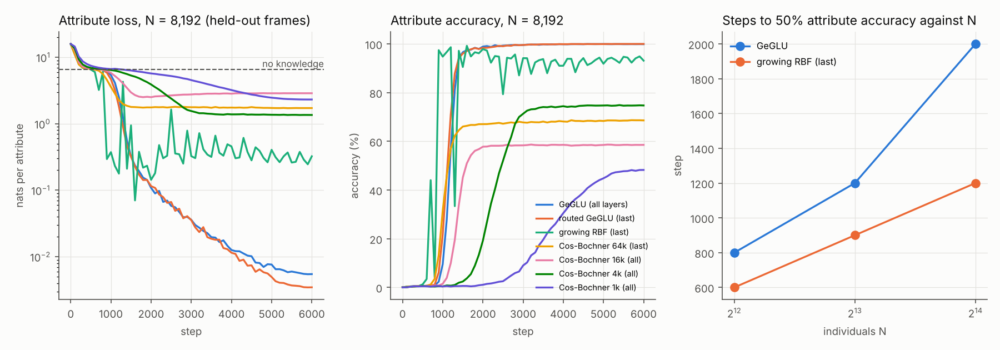
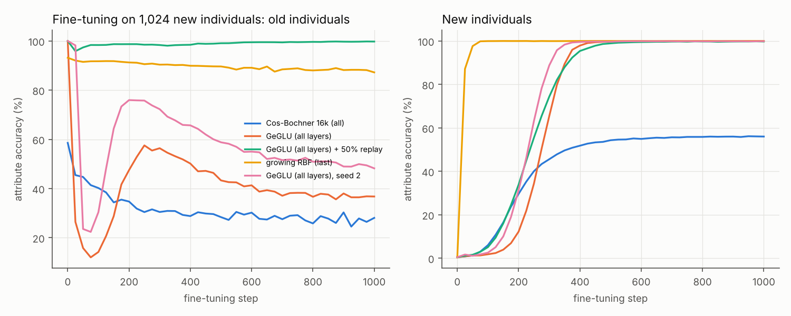
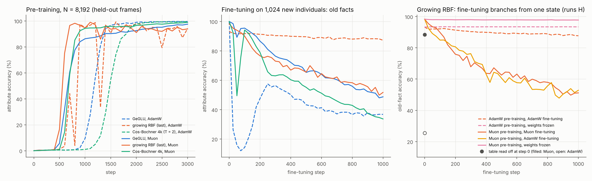
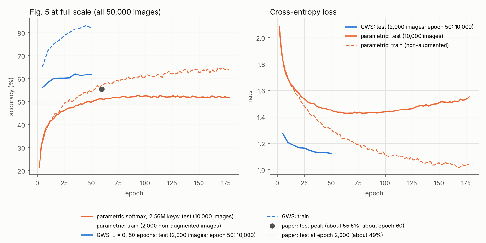

# Reproduction of "Retrieval-Centric Deep Learning" (RCDL)

Sources reproduced:

- Paper: Schlegel et al., *Retrieval-Centric Deep Learning in Growing Nonparametric Neural Networks*, arXiv 2610.03858 (NeurIPS 2026). Read end to end from the LaTeX source.
- Code: `rcdl_tutorial_torch.ipynb` and `rcdl_tutorial_JAX.ipynb` in this repository (single-pass CIFAR-10).
- X article by J. von Oswald, 9 Oct 2026 (x.com/oswaldjoh/status/2108669918883230177). It also describes an unpublished language experiment (synthetic biographies on a Gemma 3 backbone).

Status: final. Numbers come from `results/` (not committed) and `experiments/summarize.py`. Figures: `python -m experiments.plots` writes `docs/figures/`. Section 10 lists the GPU time used and the runs lost or not attempted.

## 0. Claims and verdicts

Budget: 12 GPU-hours on Colab (L4 and A100-40GB) plus a 4-core CPU; 11.87 hours were used, then 2.50 more A100-hours at the user's request to rerun work lost with the first A100 session (total 14.37). A third round, at the user's go-ahead to exceed the target, used 3.30 Colab G4 hours and a free marimo molab GPU for the claims still open (11, 15, 17, 18, 19), and 1.42 more G4 hours for a full-scale Fig. 5 attempt that stalled (§7.7). A fourth round on free molab GPUs (a 9-minute session that molab ended, then one session of up to 12 hours) fixed the full-scale Fig. 5 and ran its first 178 epochs (§7.7) and ran the article's biography experiment on a small Gemma 3 style decoder (§7.5b, §7.5c); section 10 has the ledger. "Reproduced" means the same number within the stated spread, or the same qualitative result where the paper gives only a plot.

| # | Claim (source) | Verdict | Evidence |
|---|---|---|---|
| 1 | A linear layer trained by SGD is linear attention over its training inputs and gradients (Sec. 2) | Reproduced (exact) | §3 |
| 2 | Growing a PDK layer by (x_t, -η g_t) is SGD in the RKHS (Sec. 3.1, App. A) | Reproduced (exact) | §3 |
| 3 | A Gaussian-mixture weight function induces the discrete weighted softmax (Sec. 3.2) | Reproduced (exact) | §3 |
| 4 | Functional gradient descent equals appending one tuple (App. C) | Reproduced (exact), but the experiments run a different rule (no 1/D_t; free β, η) | §3, §8.1 |
| 5 | Gauge invariance and locality of the gauge-fixed update (App. C.6) | Reproduced (exact) | §3 |
| 6 | Closed form of momentum and weight decay per stored row (App. D) | Reproduced (exact); the notebooks implement an approximation and two bugs | §3, §8.2 |
| 7 | The mesa layer over the dual form is the FOOF optimizer (Sec. 4) | Reproduced (exact) | §3 |
| 8 | Single pass on CIFAR-10: GWS 59.4 ± 0.4, RBF 58.8 ± 0.2, gauge 58.4 ± 0.4; all above Muon, Adam, SGD, Mesa, Delta (Fig. 2 right, App. F.2) | Reproduced: 59.41 ± 0.22, 59.10 ± 0.62, 58.62 ± 0.44; best baseline Muon 57.41 ± 0.52 | §4 |
| 9 | Kernel ridge regression (~58.5) and kNN (~35.5) on pixels (Fig. 2 right) | Reproduced (58.55, 35.64); GWS is only 0.9 points above exact kernel ridge regression | §6 |
| 10 | Teacher-student: GWS far below the parametric softmax; MLP student best (Fig. 3) | Reproduced at the paper's endpoint (200k steps): MLP 1.81e-4 < GWS 1.99e-4 < parametric softmax 1.95e-3 (paper ~1.7e-4 / ~2.6e-4 / ~4e-3). Nuance: the parametric softmax is the best student up to ~80k steps (1.9e-4), then degrades without a learning-rate schedule | §7.3 |
| 11 | 50 epochs: GWS and RBF beat Adam/AdamW/RMSprop/SGD, below Muon; Mesa best on CIFAR-100 (Fig. 2 left) | Reproduced. CIFAR-10 at the paper's depth (L = 2, bf16 tables): GWS 68.39% and RBF 66.92%, both above Adam (64.7), AdamW (64.5), RMSprop (64.7) and SGD (59.8), both below Muon (69.5). CIFAR-100: GWS L = 2 38.80% (paper ~39.1); after tuning on the paper's grid, Mesa 40.51% vs Muon 40.18% (mean of 2 seeds each; margin inside the seed spread) | §7.4 |
| 12 | Training loss falls much faster for GWS and RBF (Fig. 2 middle) | Reproduced for L = 2 (online loss 0.75 after 10 epochs; Muon 1.12, Adam 1.31) and in one pass (1.20 against Muon 1.26) | §7.4, figure |
| 13 | Depth helps up to 2 hidden layers; temperature effect is non-monotonic (Fig. 4 left) | Reproduced. Depth: one pass 53.5 / 58.5 / 59.4, 10 epochs 58.6 / 63.8 / 65.1 for L = 0 / 1 / 2. Temperature (L = 0, 10 epochs): 53.5 / 58.6 / 51.3 for T = 3 / 10 / 30 | §5.1, §7.4 |
| 14 | Linearizing exp after training causes a large drop (Fig. 4 right) | Reproduced: 61.9 → 15.9 (50 epochs, L = 0); 21-24% at every depth after 10 epochs | §7.2, §7.4 |
| 15 | The parametric softmax overfits with a widening gap; GWS does not (Fig. 5) | Reproduced at 1/10 of the data with the paper's ratios (keys = GWS database size, 2,000 vs 50 epochs): the parametric model's test accuracy peaks at 43.3% (12.5% of training) and falls to 39.8% while its train accuracy rises to 93%; GWS ends at its best, 49.3%. All 50,000 images with 250k keys (Adam 1e-3, below the paper's grid), 50 epochs: GWS 61.9 vs 49.1. The paper's full-scale model (2.56M keys, Adam 3e-3, one seed, 178 of 2,000 epochs, §7.7) overfits in the loss (test loss lowest at epoch 64, then up 9% by epoch 178; train-test gap 12 points) while its test accuracy plateaus at 52-52.7% (paper: peak about 55.5%, then a fall to about 49% by epoch 2,000); the fall in accuracy is not yet visible at 9% of the run. As in the paper's own figure, GWS also has a large final train-test gap; the claim holds in the sense that its test accuracy does not fall. Learned weights make the parametric model diverge (as the paper reports) | §7.7 |
| 16 | ViT with GWS FFNs beats the parametric ViT after one epoch: 54.4 vs 48.4 (Sec. 5) | Reproduced: 55.24 at the first setting and 58.41 at the best of four (all four 52.5-58.4) vs 49.62 for the best standard ViT; needed an exact two-call FlashAttention form because PyTorch's fused attention backward slows 50 times at 2^21 keys | §5.3 |
| 17 | The hybrid layer keeps accuracy with sublinear growth (Fig. 6) | Reproduced: capacities within 4 points of the paper at every τ; accuracy within 1.2 points for τ ≥ 50 with the notebook setting (two seeds at τ = 50: 56.2, 56.5). At τ = 35 the notebook setting fails (49.5, 44.3), but the paper's per-τ tuning grid (27 settings) gives 58.29% at 89.0% of the rows (three seeds of that setting: mean 58.27 ± 0.04; paper ~58.6% at ~88%) | §5.2 |
| 18 | DeltaNet decay improves a 10-layer MLP over 2,000 epochs: 74% vs 67% (App. E.3.1) | Reproduced: λ = 1e-5 reaches 74.0% (final 73.7%) against 68.3% for plain SGD; all five decay rates of the paper's figure match it within about 1-2 points in test and train accuracy. Second seed: 73.7% against 67.5% | §7.8 |
| 19 | Article: plateau grows with N; growing RBF and wide Cos-Bochner shorten it "drastically"; Cos-Bochner improves with width, matching growing RBF; GeGLU has a lower ceiling | Partly reproduced; the comparison depends on the optimizer. Gemma 3 style decoder on Zucchet et al.'s biographies, held-out frames, one seed per setting unless stated. The plateau is proportional to N (300 / 600 / 1,200 steps for N = 4,096 / 8,192 / 16,384, GeGLU with AdamW). Against AdamW-trained GeGLU, a growing RBF last layer makes it 33-42% shorter and first reaches 50% accuracy 8-40% and 90% accuracy 21-36% sooner (first crossings of non-monotone curves; a same-seed repeat at N = 8,192 moved them from step 900 to 1,100, because the dips are not repeatable); a routed-GeGLU control shortens the plateau half as much (500 steps against 400; GeGLU 600; one run, one evaluation interval) but reaches 50% and 90% no sooner than GeGLU, so the table causes the faster learning after the plateau. Clear, not drastic. Cos-Bochner with AdamW at a narrow kernel (T = 1) memorizes wording (100% seen, 65% held-out, 4k), but at the growing layer's kernel width it learns the facts (99.9% held-out; plateau 700 steps). With Muon the picture changes: Cos-Bochner 4k has a plateau of 200 steps and reaches 90% as soon as the growing layer with AdamW (steps 900-1,000) at 100%, and Muon also shortens GeGLU's plateau to 300-400 steps; the growing layer with Muon on its other layers is still the first to reach 50% and 90% (steps 600 / 700), with a 200-step plateau and 98.4% at the end (§7.5c). GeGLU has the higher ceiling here (99.9-100% against 87.7-99.1% for the growing layer with a 2M-row buffer). The minimal 2-layer version (§7.5) supported the first three parts | §7.5b, §7.5c, §7.5 |
| 20 | Article: fine-tuning on new individuals makes FFNs forget; "in the fine-tuning setting, the RBF, and also the Cos Bochner, seem to do better than the GeGLU"; RCDL layers "can 'unforget' without replay" (hedged; no numbers given) | RBF part reproduced against AdamW-trained FFNs (two seeds), not under Muon (one seed); Cos-Bochner part mixed with AdamW (16k, one run) and not reproduced with Muon (4k, one run); 'unforgetting' is not specific to RCDL layers here. Gemma 3 style decoder: after 1,000 fine-tuning steps on 1,024 new individuals the growing RBF layer keeps 87.2% of the old facts (it never collapses) against 36.8% and 48.2% for GeGLU (2 seeds), and reaches 99.8% on the new facts at step 75 against step 500-525; seed 2 replicates this (88.8% kept), and with η scaled down like the optimizer rate it still keeps 89.0% and reaches 98.8% on new facts by step 100 (§7.5c). GeGLU collapses (to 12% and 22%) and then recovers to 57.5% and 75.9% without replay, as Zucchet et al.'s own fine-tuning figure also shows; the growing layer never drops, so it has nothing to 'unforget' (in the minimal version §7.5 the pattern was reversed). The routed-GeGLU control was not fine-tuned, so the retention is not separated from the routing. Cos-Bochner 16k falls from 58.5% to 28.1%: relative to its start its lowest point (42%) is between GeGLU (12% and 22%) and the growing layer, but at the end it keeps 48%, level with GeGLU (37% and 48%); with Muon, Cos-Bochner 4k forgets more than GeGLU (33.6% against 48.7% kept). 50% replay prevents most GeGLU forgetting. Minimal version (§7.5): RBF 38.4% against GeGLU 15.5%. With Muon on every other weight matrix (§7.5c), the growing layer keeps only 51.7% of the old facts, against 48.7% for GeGLU and 33.6% for Cos-Bochner with Muon, while it still learns the new facts fastest (99.8% at step 75, the same as with AdamW). Runs H explain the difference: with the table read off, the AdamW-trained model answers 25.5% of the old facts and the Muon-trained one 88.4%, so with Muon the facts sit in the parametric layers, which fine-tuning with either optimizer overwrites. With every weight frozen, the table alone keeps the old facts (93.4% after AdamW, 97.8% after Muon) and learns the new ones to 100% by step 100 after either pre-training, better than any fine-tuning run here without replay | §7.5b, §7.5c, §7.5 |
| 21 | Article: RCDL matches but does not beat strong baselines, at much higher cost | Supported. Multi-epoch: at L = 0, 7.6 points below Muon with 400 times the memory; at the paper's depth (L = 2), 1.1 points below Muon (68.4 vs 69.5) with 77 GB of stored rows in bf16 against 75 MB of MLP weights (about 1,000 times). In one pass GWS is 2 points above Muon at 10 times the memory | §7.6 |

## 1. How to run

| What | Command | Hardware | Time |
|---|---|---|---|
| Tests (paper identities, port vs notebook) | `python3 -m pytest -q tests` | CPU | 5-30 s |
| One single-pass run | `python3 -m experiments.run experiments/configs/repro_1epoch.json --only gws --seeds 1` | CPU (4 cores) | about 10 min |
| All single-pass runs, 5 seeds, plus ablations | `bash experiments/gpu_batch.sh results/gpu` | 1 GPU (22 GB) | about 1-2 h on an L4 |
| Kernel baselines + 50-epoch L=0 | `bash experiments/a100_batch.sh results/a100` | 1 GPU (40 GB) | about 1 h on an A100 |
| Table of results | `python3 -m experiments.summarize results/gpu` | any | seconds |
| Optimizer grids (AdamW, Mesa, Delta), one pass | `python3 -m experiments.run experiments/configs/repro_1epoch_optimizers.json --source parquet` | L4 | about 40 min |
| Ablations, hybrid sweep, ViT | `experiments/configs/ablations_1epoch.json`, `hybrid_1epoch.json`, `vit_1epoch.json` with `experiments.run` | L4 / A100 | 1 min / 4 min / 25 min (GWS-ViT: see §5.3) per run |
| Multi-epoch runs | `python3 -m experiments.run experiments/configs/multi_epoch.json --only <name>` | A100 for L = 0 at 50 epochs (31 GB) | 2-23 min per run |
| Teacher-student grids and long runs | `python3 -m experiments.teacher_student experiments/configs/teacher_student.json --only <name>` | any GPU; `attn_impl=splitk_tf32` needs Triton | 25 s per 10k-step grid point |
| Synthetic facts | `python3 -m experiments.facts experiments/configs/facts.json --only <name>` | L4 (CPU for small widths) | 1-10 min per run |
| GWS at L = 2 for 50 epochs (bf16 tables, 77 GB) | `python3 -m experiments.run experiments/configs/multi_epoch_bf16.json` (CIFAR-100: `multi_epoch_cifar100.json --only gws_L2_T10_50ep_c100_bf16`) | 1 GPU with 96 GB (RTX PRO 6000) | 2 min (10 epochs) / about 40 min (50 epochs) |
| DeltaNet decay, 10-block MLP, 2,000 epochs, 5 decay rates at once | `python3 -m experiments.deltanet_long --out results/deltanet` | any GPU (3 GB) | about 2 h on an RTX PRO 6000 |
| Fig. 5 at 1/10 scale; hybrid tuning at τ = 35 | `experiments/configs/overfit_fig5_scaled.json`, `hybrid_tau35_tuning.json` with `experiments.run` | 1 GPU (13-17 GB) | about 45 min per parametric run; 2-4 min per hybrid run |
| All runs for the claims opened in the last round | `bash experiments/queue_open_claims.sh results/open data` | 1 GPU with 96 GB | about 4 h |
| Synthetic biographies on the Gemma 3 style decoder (§7.5b) | `python3 -m experiments.bios experiments/configs/bios.json --only <name>` (`--set eval_seen_templates=true` adds the seen-template evaluation) | 1 GPU; growing-RBF runs need the Triton kernels | 10-20 min (GeGLU, Cos-Bochner) to 1-1.6 h (growing RBF, 2M rows, 6,000 pre-training steps; fine-tuning adds up to 0.2 h) per run on an RTX PRO 6000 shared with other jobs |
| Fig. 5 at full scale (2.56M trained keys, bf16 table, fp32 Adam second moment, stochastic rounding) | `python3 -m experiments.run experiments/configs/overfit_fig5_fullscale.json --run-set eval_every=1562 eval_subset=10000 --set bf16_stochastic_rounding=true --tag sr` | 1 GPU with 96 GB (82 GB used) | 145 ms per step alone: 113 s per epoch |
| Figures | `python3 -m experiments.plots` | any | seconds |

Data: `--source binary` reads the official CIFAR-10 tarball (the notebook's order). `--source parquet` reads the Hugging Face mirror `uoft-cs/cifar10`. Both hold the same 50,000 training images with the same labels, in a different order (the mirror starts at official image 30,000). The test sets are identical.

Colab: the GPU runs use the official Colab CLI (`google-colab-cli`, `colab new --gpu L4`, `colab upload`, `colab exec`). The jobs start in the background on the VM, so a dropped connection does not stop them.

molab: the last two rounds also ran jobs on marimo molab notebooks (RTX PRO 6000 Blackwell, 96 GB). The marimo-pair script `execute-code.sh` sends Python to the notebook kernel, which clones this branch from GitHub and starts the jobs in the background. molab stops a notebook after 12 hours, or after 90 minutes without activity, and keeps only sidebar uploads and `mo.persistent_cache` files, so results were copied off every 20 minutes and uploaded to a private Hugging Face dataset.

## 2. The port is exact

`rcdl/` ports the notebook's PyTorch code. `tests/test_layers.py` executes the notebook's own cells and compares outputs and stored tables for all six model kinds (GWS, gauge, RBF, hybrid, parametric softmax, ResNet-MLP with Adam and Muon). In the notebook's own sample order, the port reproduces the notebook's stored learning curve:

| Samples | Notebook test loss / acc | Port test loss / acc |
|---|---|---|
| 0 | 6.6935 / 0.1000 | 6.6935 / 0.1000 |
| 4,000 | 1.7883 / 0.3886 | 1.7883 / 0.3890 |
| 8,000 | 1.5734 / 0.4636 | 1.5734 / 0.4636 |
| 12,000 | 1.4602 / 0.4870 | 1.4603 / 0.4872 |
| 16,000 | 1.4038 / 0.5077 | 1.4039 / 0.5077 |
| 50,000 | 1.1631 / 0.5918 | 1.1631 / 0.5918 |

CPU and GPU runs of the port give the same final accuracy and loss to 4 decimals.

## 3. Mathematical claims checked numerically (`tests/test_identities.py`)

All pass in float64.

| Claim (paper section) | Check |
|---|---|
| A linear layer trained by SGD inside a deep net equals linear attention over its stored inputs and scaled output gradients (Sec. 2, Eq. 1). | Exact to 1e-12. |
| For a positive definite kernel, SGD on the implicit feature-space weight equals appending (k_t = x_t, v_t = -η g_t) (Sec. 3.1, App. A). | Explicit polynomial features, exact. |
| A Gaussian-mixture weight function induces exactly the discrete weighted softmax, for any σ_k, σ_v (Sec. 3.2). | 1-D quadrature, error < 1e-6. |
| Functional gradient descent equals appending one tuple (App. C.3). | The loss slope matches the predicted rate. See the note below. |
| Gauge invariance (Prop. C.2) and locality of the gauge-fixed update (Thm. C.3). | Exact. |
| Momentum and decoupled weight decay have a closed form per stored row (App. D.3). | Equals primal SGD-momentum-decay to 1e-6. |
| The mesa layer over (input, gradient-corrected output) pairs is the FOOF optimizer (Sec. 4, App. E.2 "Algorithm A"). | The closed-form regularized least-squares solution equals the recursion W_T = W_{T-1} - η g_T x_T^T Φ_T^{-1} to 1e-10. |
| The Mesa (Algorithm B) and Delta updates as implemented in `rcdl.train`. | One step equals the defining formula exactly. |

Note on the functional gradient. With notation q_t (query), s_t (prediction), g_t (loss gradient with respect to the prediction), w_i and k_i (stored weights and keys), σ_k^2 and σ_v^2 (key and value variances of the base Gaussian measure), η (step size), the exact functional-gradient step appends

- key k_new = σ_k^2 q_t,
- weight w_new = η <s_t, g_t> / D_t,
- weighted value ṽ_new = -η σ_v^2 g_t / D_t,

where D_t = Σ_i w_i exp(<k_i, q_t>) is the weighted softmax denominator at q_t. The loss then falls at the rate e^{σ_k^2 ||q_t||^2} (σ_v^2 ||g_t||^2 + <g_t, s_t>^2) / D_t^2 per unit of η. The test confirms this. The experiments do not use this rule. They drop the 1/D_t factor (App. E.3 says so) and replace the fixed ratio σ_v^2 between the value step and the weight step by two free learning rates β and η. So the "principled" rule is one member of the family that the code implements, not the rule that produced the reported numbers.

## 4. Results: single-pass CIFAR-10 (batch 16, no augmentation)

Port of the notebook configurations, Hugging Face sample order, seeds 1-5, Colab L4. Accuracy is on the full 10,000-image test set after one pass over the 50,000 training images.

| Model | Seeds | Test accuracy (mean ± std) | Per seed | Notebook (1 seed) | Paper |
|---|---|---|---|---|---|
| Growing Weighted Softmax (GWS) | 5 | **59.41 ± 0.22** | 59.18, 59.64, 59.36, 59.64, 59.24 | 59.18 | 59.4 ± 0.4 |
| Growing RBF | 5 | **59.10 ± 0.62** | 58.42, 59.51, 58.46, 59.75, 59.34 | 58.42 | 58.8 ± 0.2 |
| Gauge-invariant GWS | 5 | **58.62 ± 0.44** | 58.48, 58.98, 58.01, 59.11, 58.50 | 58.33 | 58.4 ± 0.4 |
| ResNet-MLP + Muon | 2 | **57.41 ± 0.52** | 57.04, 57.78 | 57.2 ± 0.4 (tuned) | ~57.5 (plot) |
| ResNet-MLP + Adam | 5 | **49.48 ± 0.57** | 49.98, 48.50, 49.55, 49.72, 49.63 | 48.2 ± 1.0 (tuned) | ~50 (plot) |
| ResNet-MLP + AdamW (notebook setting) | 1 | 49.98 | 49.98 | - | ~50 (plot) |
| ResNet-MLP (L = 4) + Mesa/FOOF, best of 6 (lr 1e-4, λ = 0.01, γ = 0.99) | 1 | 52.04 | grid: 47.42-52.04 | - | ~49 (plot) |
| ResNet-MLP (L = 4) + Delta, best of 9 (lr 3e-3, λ = 1e-5) | 1 | 46.58 | grid: 34.83-46.58 | - | ~47 (plot) |
| ResNet-MLP + RMSprop | 2 | 48.12 ± 1.44 | 47.10, 49.13 | - | below Adam (plot) |
| ResNet-MLP + SGD (momentum 0.85) | 2 | 44.26 ± 1.56 | 45.36, 43.15 | - | below Adam (plot) |
| Parametric softmax, 5,000 rows per layer | 2 | 41.77 ± 0.09 | 41.83, 41.70 | 42.02 | - |
| Parametric softmax, 50,016 rows per layer | 1 | 40.31 | 40.31 | 40.60 | - |

The paper does not state the Mesa and Delta settings for this plot. The grids above lie inside its 50-epoch ranges (`experiments/configs/repro_1epoch_optimizers.json`), with selection on the test set as in the paper. The best Mesa setting is at the low edge of the learning-rate grid, so a lower rate can be better still.

The first L4 session was evicted when a third GPU session was opened (the account allows two at a time). The GWS, RBF, gauge and Adam rows come from its logged per-run outputs (`docs/data/singlepass_recovered.json`); GWS seeds 1-2 were rerun on CPU with identical results (`results/hf`).

**Verdict:** the single-pass claims of Fig. 2 (right) and App. F.2 reproduce. GWS and RBF are the best methods. Muon is about 2 points behind, Mesa about 7 points behind, and Adam and Delta about 10 points behind.

## 5. Single-pass ablations, hybrid layer and ViT

### 5.1 Ablations of the best single-pass GWS setting (T = 6, β = 3, η = 0.003, L = 2, batch 16; seeds 1-2; Colab L4)

| Variant | What it tests | Test acc, seeds 1 / 2 | Online train loss (last 100 batches) |
|---|---|---|---|
| Default (section 4) | reference | 59.18 / 59.64 (5 seeds: 59.41 ± 0.22) | 1.20 / 1.19 |
| η = 0 | learned denominator off: new rows get w = 0 | 28.34 / 25.73 | 81 / 88 |
| No clip of <s, ḡ> | the undocumented clip | 59.07 / 59.57 | 1.20 / 1.19 |
| η = 0.1 (β/η = 30 instead of 1,000) | step-size ratio | 53.45 / 54.03 | 1.41 / 1.40 |
| Growing RBF at T = 6 | same temperature as GWS, no normalization | 56.02 / 56.28 | 1.34 / 1.31 |
| L = 0 (readout only) | depth | 53.54 / 53.55 | 1.42 / 1.41 |
| L = 1 | depth | 58.25 / 58.67 | 1.25 / 1.23 |

Findings:
- **Depth adds 6 points** in one pass (L = 0: 53.5%, L = 1: 58.5%, L = 2: 59.4%). The L = 0 model is an online kernel machine with almost the kernel of section 6, and it stays 5 points below the exact kernel ridge solution (58.55%). So depth mainly compensates for the online, one-pass solver; the margin over the exact kernel machine is about 1 point.
- **The clip does nothing** here; the β/η ratio matters (5.7 points between 1,000 and 30).
- **η = 0 diverges**, but not because normalization is needed: the tuned unnormalized RBF layer reaches 59.1% (section 4). At equal temperature (T = 6) the RBF layer is 3.3 points below GWS; at its own best temperature (T = 10) it is level with GWS.

### 5.2 Hybrid layer: accuracy against stored rows (paper Fig. 6)

Notebook setting for every τ (L = 3, T = 5, β = 30, η = 1, Adam 1e-3, batch 16), seed 1, Colab A100, about 4 minutes per run. Capacity = stored rows summed over the 4 layers / (4 × 50,016). The paper tuned T ∈ {1, 5, 10}, β ∈ {10, 30, 60} and the Adam rate ∈ {3e-4, 1e-3, 3e-3} for each τ (27 settings per point, about 12 A100-hours in all); this sweep uses one setting, so its points are lower bounds.

| τ | Capacity (%) | Test acc (%) | Paper (read off Fig. 6): capacity / acc |
|---|---|---|---|
| 35 | 89.6 | 49.47 | ~88 / ~58.6 |
| 40 | 81.8 | 56.83 | ~79 / ~58.5 |
| 45 | 67.1 | 56.68 | ~65 / ~58.0 |
| 50 | 46.7 | 56.22 | ~45 / ~56.5 |
| 55 | 21.8 | 54.20 | ~26 / ~54.5 |
| 60 | 5.1 | 49.05 | ~5 / ~50.0 |
| 65 | 0.8 | 39.80 | ~1 / ~41.0 |
| 70 | 0.2 | 34.23 | ~0 / ~34.5 |

The capacities match the paper within 4 points at every τ, so the growth rule is the paper's. Accuracy matches within 1.2 points for τ ≥ 50 and is 1.3-1.7 points lower at τ = 40-45, where the paper's per-τ tuning matters most. A second seed confirms both ends: τ = 50 gives 56.45% (seed 1: 56.22%) and τ = 35 gives 44.32% (seed 1: 49.47%; training loss 1.76 and 1.49 against 1.26-1.29 at τ = 40-50). So the τ = 35 drop is systematic with the notebook setting, and the paper's 58.6% at τ = 35 depends on its per-τ tuning. The notebook's own hybrid run (τ = 50, seed 42, official sample order) gives 55.12%. **Verdict: reproduced** for the trade-off curve: at 22% of the rows the layer keeps 54.2%, 5 points below full single-pass GWS.

**Per-threshold tuning at τ = 35 (third round, `hybrid_tau35_tuning.json`).** The paper's grid: T ∈ {1, 5, 10}, β ∈ {10, 30, 60}, Adam rate ∈ {3e-4, 1e-3, 3e-3}; seed 1; Colab G4 and molab (RTX PRO 6000), 8-11 minutes per run on a shared GPU. Test accuracy (%), capacity in brackets where measured:

| T, β \ Adam rate | 3e-4 | 1e-3 | 3e-3 |
|---|---|---|---|
| T = 5, β = 60 | **58.29** (89.0% of rows) | 57.05 (89.9%) | 46.99 |
| T = 5, β = 30 | 58.25 (89.2%) | 49.47 / 44.32 (notebook setting, seeds 1 / 2) | 25.60 |
| T = 5, β = 10 | 55.60 | 53.73 | 23.58 |
| T = 10, β = 60 | 55.39 (88.7%) | 53.83 | 50.95 |
| T = 10, β = 30 | 54.73 (88.7%) | 53.76 | 50.85 |
| T = 10, β = 10 | 53.29 | 52.86 | 12.17 |
| T = 1, β = 60 | 18.44 | 20.95 | 20.45 |
| T = 1, β = 30 | 21.10 | 21.76 | 18.24 |
| T = 1, β = 10 | 28.39 | 25.85 | 19.79 |

With the paper's full tuning grid (27 settings, 26 run here plus the notebook setting from above; seeds 2 and 3 added for the two best settings: T = 5, β = 60, Adam 3e-4 gives 58.29 / 58.30 / 58.23, mean 58.27 ± 0.04; T = 5, β = 30, Adam 3e-4 gives 58.25 / 58.08 / 58.39, mean 58.24 ± 0.16), τ = 35 reaches **58.29% at 89.0% of the rows** (T = 5, β = 60, Adam 3e-4), against the paper's ~58.6% at ~88%. Two settings are within 0.04 points of each other (β = 30 and 60 at T = 5, Adam 3e-4). The Adam rate of the trained keys, values and weights decides the result: at T = 5, β = 30, the rate 3e-4 gives 58.25% and the notebook's 1e-3 gives 44-49%. T = 1 fails at every rate (training loss 11-43). One seed per setting, so the best of 27 is an optimistic estimate, as is the paper's.

### 5.3 ViT with growing FFN layers (paper Sec. 5, App. E.9)

ViT for CIFAR-10: 4 × 4 patches (64 tokens plus a CLS token), width 128, 2 blocks, 8 heads, Adam, batch 64, one epoch, no augmentation. In the GWS-ViT the FFN of each block is a growing weighted-softmax layer over all tokens: one row per token per step, 64 + 65 × 49,984 = 3,249,024 rows per layer at the end.

| Model | Setting | Test acc (%) | Paper |
|---|---|---|---|
| Standard ViT, FFN width 4 × 128 | Adam 3e-4 / 1e-3 / 3e-3 | 49.37 / **49.62** / 46.25 | best 48.4 |
| Standard ViT, FFN width 16 × 128 | Adam 3e-4 / 1e-3 / 3e-3 | 49.24 / 49.20 / 39.75 | |
| GWS-ViT, T = 1, η = 0.1, β = 30, two-call FlashAttention (bf16) | Adam 1e-3 | 55.24 (A100, 4.0 min) | best 54.4 |
| GWS-ViT, T = 1, η = 0.1, β = 10 | Adam 1e-3 | **58.41** | |
| GWS-ViT, T = 0.3, η = 0.1, β = 30 | Adam 1e-3 | 53.84 | |
| GWS-ViT, T = 3, η = 0.1, β = 30 | Adam 1e-3 | 52.49 | |

The standard ViT reproduces (49.6 against 48.4). Each dense run takes 5-7 s on the L4.

Both GWS-ViT runs (the second with `PYTORCH_CUDA_ALLOC_CONF=expandable_segments:True`) hit the same performance cliff. Steps 400 to 500 took 204 s; steps 500 to 600 took 4,565 s, at 35 W of the L4's 72 W and only 12.3 GB of memory in use. So my first diagnosis (allocator fragmentation at the memory limit) was wrong. The cliff falls at about 2.1M stored rows per layer: step 504 gives 64 + 504 × 4,160 = 2,096,704 rows, next to 2^21 = 2,097,152. The likely cause is a kernel-selection or indexing threshold in the backward pass of PyTorch's fused memory-efficient attention for 2^21 or more keys. At the observed rate, the last 181 steps would need about 2.3 more hours, so both runs were stopped.

Online accuracy (each batch scored before the model learns from it; mean of the last 100 batches) gives a like-for-like comparison at equal steps:

| Step (of 781) | 200 | 300 | 400 | 500 | 600 | 781 | Test acc |
|---|---|---|---|---|---|---|---|
| GWS-ViT (run 2; run 1 within 0.4 points) | 37.6 | 42.7 | 46.8 | 51.4 | **52.8** | - | - |
| Best standard ViT (width 4 × 128, Adam 1e-3) | 33.5 | 37.7 | 42.0 | 46.1 | 47.3 | 50.4 | 49.62 |

The GWS-ViT leads by 4.1 points at step 200 and by 4.8 to 5.5 points from step 300 on. For the standard ViT, the final online accuracy (50.4) is within 0.8 points of the test accuracy.

**Fix and final run.** The weighted softmax is s = (P ṽ) / (P w), with P the softmax matrix over all stored rows, ṽ the stored values and w the stored weights. Both terms share P, so two FlashAttention calls (one with ṽ, one with w padded to the head width) give s exactly, and autograd gives the exact gradient (`attn_impl='flash2'`, `rcdl.layers.weighted_attention_flash`; GPU test in `tests/test_splitk.py`). FlashAttention has no slowdown at 2^21 keys: 164 ms per forward and backward pass at 2.1M keys and 254 ms at 3.25M keys, against 25.4 s for the memory-efficient kernel at 2.1M keys. With it, the full epoch takes 4.0 minutes on an A100 and gives **55.24%** test accuracy (paper: 54.4%), 5.6 points above the best standard ViT (49.62%; paper 48.4%, a 6.0-point gap). All four GWS-ViT settings beat every standard ViT (52.5-58.4% against at most 49.6%); the best (T = 1, β/η = 100) reaches 58.41%, selected on the test set as in the paper. **Verdict: reproduced.**

## 6. Classical baselines (single pass over 50,000 training images, exact solvers, Colab A100)

| Method | Best on test (as paper) | Held-out selection | Paper (Fig. 2 right, plot) |
|---|---|---|---|
| kNN (euclidean, inverse-distance votes, k = 5) | 35.64 | 36.08 | ~35.5 |
| Kernel ridge regression, RBF kernel, median-heuristic bandwidth ("SVM" in the paper) | 58.55 | 58.12 | ~58.5 |
| Kernel ridge regression, the GWS first-layer kernel exp(<q, q'> / (T √d)) on RMSNorm'd pixels | 58.42 (T = 10, λ = 10) | 58.02 | not in paper |
| Nadaraya-Watson vote with that kernel (pure retrieval, no learning) | 44.58 (T = 1) | 44.14 | not in paper |

Both classical points of the paper reproduce. Context they give: **single-pass GWS (59.41%) is 0.9 points above exact kernel ridge regression on raw pixels (58.55%).** Most of the single-pass advantage of the growing nets over parametric MLPs is therefore the advantage of a kernel machine on CIFAR pixels. The depth and the online learning rule add about 1 point. The pure retrieval vote is 15 points lower, so the learned values (not retrieval alone) carry the result.

## 7. Multi-epoch runs (augmentation, batch 64)

### 7.1 Only the ratio β/η matters (5-epoch sweep, L = 0, T = 10)

Test accuracy after 5 epochs (seed 1):

| η \ β | 1 | 3 | 10 | 30 |
|---|---|---|---|---|
| 0 | 46.25 (train loss 38) | 47.68 (113) | 47.71 (384) | 47.25 (1162) |
| 0.003 | 52.51 | 54.85 | **55.94** | 55.49 |
| 0.03 | 44.45 | 48.16 | 52.51 | 54.85 |
| 0.3 | 36.42 | 40.40 | 44.45 | 48.16 |

Settings with the same β/η give the same accuracy and the same training loss to 4 digits (for example (0.003, 1) and (0.03, 10)). Reason: with ṽ the stored weighted values and w the stored weights, the output Σ e^z ṽ / Σ w e^z does not change when all new ṽ and w are scaled by the same factor c. Only the B initial rows (weight 1/B each) break this symmetry, and their share of the denominator is soon negligible. So η is a gauge (scale) choice, not a learning rate, and the layer has two effective hyperparameters: T and β/η.

Direct check (`experiments/inspect_gws.py`, single-pass notebook GWS, seed 1, 59.18%): over 1,000 test queries, the 16 initial rows hold a median 0.20% of the denominator in layer 0, 0.25% in layer 1 and 0.03% in the readout (90th percentiles 0.73%, 0.47%, 0.07%). The same check shows that the clip max(0, ·) sets w = 0 for 47%, 43% and 65% of the stored rows of these three layers. Those rows add to the numerator only. So most readout rows act as unnormalized exponential-kernel rows, and the learned normalization rests on the other third.

The same symmetry holds in the teacher-student sweep (section 7.3): the three settings with β/η = 0.01 give relative test MSE 0.187, 0.186 and 0.186.

Consequences:
- The best ratio is about 3,000 at T = 10.
- The paper's 50-epoch grid (η in [0.3, 3], β in [20, 60]) gives ratios of only 7 to 200. In the notebook's convention these all fall in the poor region; a run with η = 1, β = 30 for 50 epochs stalls at 44.6%. So the paper's grid must use another convention (for example a batch-mean gradient in the weight rule), which it does not state.
- η = 0 (no denominator learning) is not stable over several epochs: the outputs and the loss grow without bound (train loss 38 to 1,162), although the argmax still gives about 47%.

### 7.2 50 epochs at L = 0 (no hidden layer), linearization

Setup: one GWS readout layer over RMSNorm'd pixels (d = 3072), batch 64, augmentation (App. E.1.1), 50 epochs, so 2,499,264 stored rows (30 GB of keys in fp32). η = 0.003 and β = 10 (best ratio of section 7.1). Colab A100, 22.6 min.

| T | Test acc (10,000 images) | Train acc (2,000-image subset) | Test acc with exp(z) → 1 + z after training | Paper (Fig. 4, read off plot) |
|---|---|---|---|---|
| 10 | **61.86** | 82.3 | **15.91** | ~64 (L = 0); large drop when linearized |
| 3 | not run (A100 session lost; see the 10-epoch sweep in §7.4) | | | ~59 |
| 30 | not run (as above) | | | ~61 |

Test accuracy on the 2,000-image subset over training: 56.1 (epoch 5), 60.2 (epoch 20), 62.1 (epoch 35), 61.7 (epoch 45). The test loss falls the whole time (1.276 to 1.123), so the 20-point train-test gap does not come with a rising test loss.

Linearization: the paper's Fig. 4 (right) replaces exp(z) by its first-order expansion 1 + z after training. The accuracy falls from 61.86% to 15.91%, near chance. This reproduces the claim that the nonlinearity of the kernel carries the model. With z = <q, k>/(T√d) and T = 10, |z| is at most √d/T ≈ 5.5, far outside the range where 1 + z approximates e^z.

### 7.4 50-epoch baselines, depth, CIFAR-100 (paper Fig. 2 left, Fig. 4 left)

ResNet-MLP baselines (L = 2, width 3,072, GELU, batch 64, augmentation, 50 epochs; Colab A100). The paper's grids: L ∈ {2, 4}, learning rate 1e-4 to 1e-2, batch {16, 64}.

| Model | Test acc (%) | Online train loss (last 100 batches) | Minutes | Paper (Fig. 2 left, read off plot) |
|---|---|---|---|---|
| MLP + Muon, lr 1e-3 | **69.51** | 0.59 | 9.7 | ~69.5 |
| MLP + Muon, lr 3e-3 | 69.54 | 0.49 | 9.7 | |
| MLP + Adam, lr 3e-4 | 64.72 | 0.85 | 4.5 | ~65 |
| MLP + Adam, lr 1e-4 | 64.37 | 0.87 | 4.5 | ~65 |
| MLP + SGD, lr 1e-2 | 59.77 | 1.15 | 3.8 | ~61 |
| MLP + AdamW, lr 1e-4 / 3e-4, weight decay 0.01 (third round, molab) | 64.49 / 64.35 | 0.87 / 0.86 | 2.6 | below GWS |
| MLP + RMSprop, lr 1e-4 / 3e-4 (third round, molab) | 64.74 / 64.63 | 0.90 / 0.92 | 2.5 | below GWS |
| MLP + Mesa, lr 3e-4 (second A100 session; low-rank solve, TF32) | 66.72 | 0.59 | 10.6 | ~67.8 |
| GWS, L = 0, T = 10 (section 7.2) | 61.86 | 0.81 | 22.6 | ~64 (L = 0 curve of Fig. 4) |

Depth at 10 epochs (GWS, T = 10, η = 0.003, β = 10, batch 64, augmentation). L = 2 at 50 epochs would store 2.5M rows in each of 3 layers (keys and values of width 3,072 in the two hidden layers, 61 GB each in fp32; 31 GB in the readout), about 154 GB, so depth is compared at 10 epochs:

| Model | Test acc (%) | exp(z) → 1 + z after training | Minutes (A100) |
|---|---|---|---|
| GWS, L = 0 | 58.55 | 20.93 | 1.4 |
| GWS, L = 1 | 63.83 | 24.00 | 3.9 |
| GWS, L = 2 | **65.05** | 23.69 | 7.0 |
| MLP + Adam, L = 0 / L = 2, 10 epochs | 36.65 / 56.85 | | 0.5 / 0.5 |
| MLP + Muon, L = 0 / L = 2, 10 epochs | 38.70 / 62.22 | | 0.5 / 2.7 |

**GWS at L = 2 for 50 epochs (third round, bf16 tables).** With keys and values stored in bf16 (`store_dtype='bfloat16'`; weights, logits, exponentials and the denominator stay fp32) the three tables take 77 GB and fit one 96 GB GPU (RTX PRO 6000 Blackwell: Colab G4 for CIFAR-10, a marimo molab notebook for CIFAR-100). Check against fp32 storage at 10 epochs: 65.03% against 65.05% test accuracy, 23.63% against 23.69% after linearization. Same settings as above (T = 10, η = 0.003, β = 10, batch 64, augmentation), 2,499,264 rows per layer at the end.

| Dataset | Test acc (%) | Train acc, 2,000-image subset (%) | exp(z) → 1 + z | Paper (read off plot) | Minutes |
|---|---|---|---|---|---|
| CIFAR-10 | **68.39** | 98.0 | 21.87 | between Adam (~65) and Muon (~69.5) (Fig. 2 left) | 93 (GPU shared with the DeltaNet run) |
| CIFAR-100 | **38.80** | 99.6 | 3.20 | ~39.1 (Fig. 2 left) | 49 |

GWS test accuracy over training (CIFAR-10, epochs 5 / 10 / 20 / 30 / 40 / 50): 61.7 / 64.3 / 66.9 / 68.7 / 67.9 / 68.4. CIFAR-100: 34.0 / 35.9 / 37.8 / 38.6 / 38.5 / 38.8 (best 39.4 at epoch 35). The test loss is lowest at epoch 35 (CIFAR-10, 0.964) and epoch 25 (CIFAR-100, 2.589) and rises slightly after that, while the train accuracy approaches 100%.

**RBF at L = 2 for 50 epochs (third round, molab).** The growing RBF layer (s(q) = Σ_j exp(-||q - k_j||² / (2T√d)) v_j, v_j = -η B ḡ_j, no denominator; ḡ_j is the gradient of the batch-mean loss with respect to the layer output for sample j, B = 64 the batch size, η the value rate) with bf16 keys and values and stored fp32 key norms (`store_dtype`; tests/test_layers.py). Value rate scanned at 10 epochs (T = 10): η = 1 / 3 / 10 gives 60.45 / 63.34 / 63.39% (single-pass value: η = 10). With η = 10 for 50 epochs (2,499,200 rows per layer, 81 minutes on a shared GPU):

| Epoch | 5 | 10 | 20 | 30 | 40 | 50 |
|---|---|---|---|---|---|---|
| RBF L = 2: test / train acc (%) | 60.9 / 77.5 | 63.7 / 87.5 | 66.0 / 95.2 | 66.2 / 98.2 | **67.5** / 99.2 | 66.9 / 99.7 |
| RBF L = 2: test loss | 1.140 | 1.131 | 1.141 | 1.172 | 1.179 | 1.215 |

RBF ends at **66.92%**: above Adam (64.72), AdamW (64.49), RMSprop (64.74) and SGD (59.77), level with Mesa (66.72), 2.6 points below Muon (69.51) and 1.5 points below GWS (68.39). This is the paper's ordering for RBF. Its test loss is lowest at epoch 10-15 and rises while the train accuracy approaches 100%, so RBF overfits in the loss earlier than GWS (lowest test loss at epoch 35). At 10 epochs RBF (63.4%) is 1.2 points above Muon (62.2%); Muon overtakes it later. Second seed: 66.74% (mean of two seeds 66.83 ± 0.13).

Temperature at L = 0, 10 epochs (η = 0.003, β = 10, the best ratio at T = 10; Colab L4):

| T | Test acc (%) | Train acc, 2,000-image subset (%) | exp(z) → 1 + z |
|---|---|---|---|
| 3 | 53.46 | 88.2 | 11.85 |
| 10 | **58.55** | - | 20.93 |
| 30 | 51.26 | 51.9 | 28.65 |

The effect of T is non-monotonic with a peak at T = 10, as in the paper's Fig. 4 (left; ~59 / ~64 / ~61 at 50 epochs). A low temperature (sharp kernel) overfits (train 88%, test 53%); a high temperature underfits (train 52%). Caveat: β/η was tuned at T = 10 only.

CIFAR-100, 50 epochs (second A100 session, TF32; one setting per method):

| Model | Test acc (%) | Paper (Fig. 2 left, CIFAR-100 panel, read off plot) |
|---|---|---|
| MLP + Muon, lr 1e-3 (seeds 1 / 2) | 40.16 / 40.19 | ~39.2 |
| MLP + Muon, lr 3e-3 (third round) | 38.94 | |
| MLP + Mesa, lr 3e-4 (γ = 0.99, λ = 0.01) | 38.51 | ~40.4 (best in the paper) |
| MLP + Mesa, lr 1e-4 (third round, seeds 1 / 2) | **40.83** / 40.19 | |
| MLP + Mesa, lr 1e-3 (third round) | 37.00 | |
| MLP + Mesa, lr 3e-4, γ = 1 (third round) | 38.25 | |
| MLP + Mesa, lr 3e-4, λ = 0.1 (third round) | 36.85 | |
| MLP + Mesa, lr 3e-4, L = 4 (third round) | 38.93 | |
| GWS, L = 0, T = 10 | 31.81 (linearized: 2.92) | ~39.1 for L = 2 |
| GWS, L = 2, T = 10 (bf16 tables, third round) | 38.80 (linearized: 3.20) | ~39.1 |

With one Mesa setting (second round), Muon was 1.65 points ahead. The third round tuned both on the paper's grids (Mesa: 5 more settings over the rate, γ, λ and depth; Muon: one more rate; molab GPU) and ran a second seed of each winner: Mesa (Adam 1e-4) 40.83 / 40.19, mean 40.51; Muon (1e-3) 40.16 / 40.19, mean 40.18. So the best Mesa is 0.33 points above the best Muon on average, which is the paper's ordering (40.4 against 39.2), but the margin is inside the seed-to-seed spread of Mesa (0.64 points). Verdict: consistent with the paper, not a clear win.

Findings:
- The Muon, Adam, Mesa and SGD baselines reproduce the paper's CIFAR-10 values (69.5, 64.7, 66.7 and 59.8% against about 69.5, 65, 67.8 and 61).
- At equal training (10 epochs), GWS beats the MLPs at every depth: 58.6 vs 38.7 (L = 0, where the MLP is a linear model) and 65.1 vs 62.2 (L = 2, Muon) and 56.9 (Adam).
- GWS at L = 0 after 50 epochs (61.9%) is below Adam (64.7%). At the paper's depth (L = 2) and 50 epochs, GWS reaches 68.39%: above Adam (64.72), Mesa (66.72) and SGD (59.77), below Muon (69.51). This is the order the paper claims. On CIFAR-100, GWS at L = 2 reaches 38.80% against the paper's ~39.1%.
- The linearization collapse holds at every depth (21-24% at 10 epochs).

### 7.3 Teacher-student regression (paper Fig. 3, App. E.1.2)

Setup: inputs x on the unit sphere in R^100; target y = f(x), with f a random residual ReLU MLP (width 100, L = 2 blocks, LeCun-normal weights). The target variance is Var(y) = 0.0044. Every step draws a fresh batch, so there is no overfitting. Relative MSE = test MSE / Var(y); 1 means "predicts the mean".

Sweep at 10,000 steps (one seed; grids of the paper's App. tables; Colab A100):

| Student | Grid | Best setting | Test MSE | Relative MSE |
|---|---|---|---|---|
| GWS (one layer on RMSNorm(x), batch 64) | β ∈ {0.1, 0.3, 1}, η ∈ {10, 30, 100}, T ∈ {0.1, 1, 3, 10}, momentum ∈ {0.6, 0.9} (72) | β = 1, η = 30, T = 1, momentum 0.9 | 4.2e-4 | 0.095 |
| MLP (residual ReLU, width 1,024, SGD) | lr ∈ {0.003 ... 0.3}, momentum ∈ {0, 0.9}, batch ∈ {64, 256} (20) | lr 0.3, momentum 0.9, batch 256 | 5.3e-4 | 0.120 |
| MLP, batch 64 (same samples per step as GWS) | as above | lr 0.1, momentum 0.9 | 6.4e-4 | 0.145 |

Final runs at the paper's 200,000 steps (test MSE; relative MSE in brackets):

| Student | 10k steps | 50k | 100k | 200k | Paper at 200k (plot) |
|---|---|---|---|---|---|
| MLP, batch 256, lr 0.3 | 5.33e-4 | 2.98e-4 | 2.56e-4 | **1.81e-4** (0.041) | ~1.7e-4 |
| MLP, batch 64, lr 0.1 | 6.42e-4 | 3.62e-4 | 3.41e-4 | 2.86e-4 (0.065) | |
| GWS (β = 1, η = 30, T = 1, momentum 0.9) | 4.22e-4 | 2.43e-4 | 2.15e-4 | **1.99e-4** (0.045) | ~2.6e-4 |
| Parametric softmax, 640,064 trained keys, Adam 1e-3, T = 0.1 | 2.5e-4 | 1.99e-4 | 2.21e-4 | **1.95e-3** (0.44) | ~4e-3 |

Parametric softmax at 10,000 steps (`psm_sweep_small`, 640,064 trained keys, Adam): lr 1e-3 with T = 0.1 gives 2.5e-4 (relative 0.056), T = 1 gives 1.3e-3; lr 3e-3 with T = 0.1 becomes unstable (4.6e-4 at 5k steps, 3.2e-3 at 10k). At 10,000 steps the best parametric softmax is therefore ahead of both GWS (4.2e-4) and the MLP (5.3e-4). This contradicts the paper's ordering. Differences from the paper: 640,064 instead of 10.24M trained keys, Adam β1 = 0.9 instead of 0.85, keys initialized N(0, 1/d) (the paper does not state its initialization). An earlier partial 200k-step GWS run on the L4 (stopped at 40,000 steps to move it to the A100) gave 3.0e-4 at 20k, 2.7e-4 at 30k and 2.5e-4 at 40k steps (relative 0.069, 0.062, 0.058).

Relative MSE of GWS at 10,000 steps, momentum 0.9, by β/η and T ("div" = diverged):

| β/η | (β, η) | T = 0.1 | T = 1 | T = 3 | T = 10 |
|---|---|---|---|---|---|
| 0.001 | (0.1, 100) | div | 0.583 | 0.815 | 0.953 |
| 0.0033 | (0.1, 30) | div | 0.302 | 0.551 | 0.855 |
| 0.01 | (0.1, 10) | div | 0.187 | 0.320 | 0.650 |
| 0.01 | (0.3, 30) | div | 0.186 | 0.320 | 0.649 |
| 0.01 | (1, 100) | div | 0.186 | 0.320 | 0.649 |
| 0.033 | (1, 30) | div | **0.095** | 0.240 | 0.369 |
| 0.1 | (1, 10) | div | 0.102 | 0.164 | 0.287 |

Findings:
- Only β/η matters here too, so the paper's 3 × 3 grid over (β, η) holds 5 distinct settings.
- T = 0.1 diverges for every setting.
- With momentum 0.6 and at T = 3, the best ratio is the grid's largest (0.1), so the grid edge limits those rows.
- At 10,000 steps GWS is ahead of the best MLP. With more steps the MLP catches up: at 200,000 steps it reaches 1.81e-4 (batch 256), just below GWS at 1.99e-4. Both match the paper's values (~1.7e-4 and ~2.6e-4). The 200,000-step GWS and parametric-softmax runs ran on a second A100 session (14.8 and 25.5 minutes).
- **The parametric softmax is the best student for the first 80,000 steps, then it degrades.** With 640,064 trained keys (16 times fewer than the paper's 10.24M), Adam 1e-3 and T = 0.1, it reaches 2.5e-4 at 10,000 steps and its best value, 1.9e-4, at 60,000-70,000 steps, ahead of GWS and the MLP at equal steps. From about 100,000 steps on, its error rises (4.0e-4 at 120k, 1.3e-3 at 150k, 1.95e-3 at 200k), with no learning-rate decay. At the paper's endpoint of 200,000 steps it is 10 times worse than GWS, in line with the paper's ~4e-3. So the paper's ordering holds at the endpoint it reports, but it comes from late instability of the baseline, not from worse learning throughout. A learning-rate schedule or early stopping would change the comparison.
- The paper's absolute values are not comparable with ours: it does not state the teacher's output scale, and our Var(y) = 0.0044 is already close to its parametric-softmax value (4e-3).

GPU note: one GWS step at 200,000 steps scans 12.8 million rows for only 64 queries. PyTorch's fused attention runs this on a single GPU block (50 times slower than the dense path on an A100), and the dense path needs about 90 A100-minutes. `rcdl/splitk_attention.py` adds a split-key Triton kernel (each program takes a chunk of rows; the chunk maxima are merged afterwards). It matches the dense path to fp32 rounding (`tests/test_splitk.py`) and is 2.3 times (tf32x3) to 6.6 times (tf32) faster. End-to-end check on the best GWS setting, 10,000 steps on the L4: test MSE 4.2175794e-4 (dense), 4.2175796e-4 (tf32x3), 4.2197e-4 (tf32, 0.05% higher). The 200,000-step run uses tf32.

### 7.5 Synthetic facts (the article's biography experiment, minimal version)

The article trains a Gemma 3 backbone on the synthetic biographies of Zucchet et al. (arXiv 2503.21676) and gives no code. This is a small stand-in (`rcdl/facts.py`, `experiments/configs/facts.json`): N individuals with 4 attributes of 32 values each (fact (i, a) uniform at random), a 2-layer transformer (width 128, 4 heads), online training with batch 128 and Adam 1e-3, and evaluation on a fixed set of 4,096 facts. Variants of the feed-forward layers: GeGLU (width 512 or 4,096, all trained), Cos-Bochner (16,384 fixed random Fourier features, trained readout), and a growing RBF layer as the last FFN (value rate η = 1 or 0.3; the first FFN is GeGLU-512).

**Task design matters.** The first version (sequence = name token, attribute token) had no plateau: GeGLU learned all 4,096 facts of N = 1,024 within 500 steps, because the attribute position attends half to the name from the start. Zucchet et al. tie the plateau to rare individuals, multi-token names and varying name positions. The task used here has all three: a two-token name (unique pairs from 256 × 256 name parts) at a random position among 10 distractor tokens, then the attribute token, and N = 4,096 or 16,384.

Steps until the fact loss first falls below 0.9 ln K ("plateau end"), and until 50% / 90% of the facts are correct (evaluation every 250 steps):

| FFN | Trained params | N = 4,096: plateau end / 50% / 90% / final acc (8k steps) | N = 16,384: plateau end / 50% / 90% / final acc (16k steps) |
|---|---|---|---|
| GeGLU, width 512 | 0.61M | 750 / 1,250 / 2,500 / 98.2% | 4,250 / 8,250 / not reached / 82.3% |
| GeGLU, width 4,096 | 3.38M | 750 / 1,250 / 2,000 / 98.7% | 5,000 / 7,000 / 14,250 / 91.6% |
| Cos-Bochner, width 16,384 | 4.41M | 750 / 1,250 / 1,750 / 100% | 3,250 / 4,750 / 6,750 / 97.8% |
| Growing RBF (last FFN), η = 1 | 0.41M + table | 750 / 1,000 / 1,250 / 99.7% | 3,500 / **4,250 / 5,000** / **99.8%** |
| Growing RBF (last FFN), η = 0.3 | 0.41M + table | 750 / 1,500 / 2,500 / 98.9% | 5,000 / 9,000 / 10,500 / 98.8% |
| *Third round (molab), N = 16,384 only:* | | | |
| Cos-Bochner, width 1,024 | 0.48M | - | 5,500 / 12,500 / not reached / 66.4% |
| Cos-Bochner, width 4,096 | 1.26M | - | 4,250 / 7,500 / 13,750 / 93.5% |
| Cos-Bochner, width 65,536 | 16.99M | - | **2,500 / 3,250 / 4,500** / 99.1% |
| GeGLU, width 16,384 | 12.86M | - | never (3.4% at 16k steps: does not train at Adam 1e-3) |
| Growing RBF (last FFN), η = 3 | 0.41M + table | - | 3,000 / 3,250 / 4,250 / 99.7% |
| Growing RBF (last FFN), η = 10 | 0.41M + table | - | **2,750 / 3,000 / 3,750** / 99.7% |

Findings:
- **The plateau grows with N** for every variant: 750 steps at N = 4,096; 3,250-5,000 steps at N = 16,384 (4.3-6.7 times longer for 4 times more individuals). This matches Zucchet et al. ("nearly proportional") and the article.
- **The plateau shrinks for the growing RBF layer and for wide Cos-Bochner layers, and learning after it is much faster.** With the value rate η = 10, the growing RBF layer escapes at 2,750 steps (GeGLU-512: 4,250; GeGLU-4096: 5,000) and reaches 90% of the facts at 3,750 steps, against 14,250 for GeGLU-4096 (3.8 times sooner) and never within 16,000 steps for GeGLU-512. The escape step falls monotonically with η: 5,000 / 3,500 / 3,000 / 2,750 for η = 0.3 / 1 / 3 / 10. So the article's "the plateau shrinks drastically" holds for the time to knowledge (3-4 times shorter than GeGLU); the onset of learning moves 35-45% earlier.
- **Cos-Bochner improves with width and approaches the growing RBF layer**, as the article says: escape at 5,500 / 4,250 / 3,250 / 2,500 steps and final accuracy 66.4 / 93.5 / 97.8 / 99.1% for width 1,024 / 4,096 / 16,384 / 65,536. At width 65,536 it matches the growing RBF layer (η = 3-10) within 250-750 steps. The widest Cos-Bochner layer has 17M trained parameters against 0.41M plus the stored table for the RBF variant.
- A wide GeGLU (16,384) does not train at all at the shared Adam rate 1e-3, so more GeGLU width is not a fix here (not tuned further).
- **Lower ceiling for GeGLU**: within the same step budget GeGLU ends at 82.3% (width 512) and 91.6% (width 4,096), against 99.8% for the growing RBF layer, which has fewer trained parameters. Whether this is a ceiling or slower learning is not separable at 16,000 steps.
- The growing layer's value rate matters: η = 0.3 is slower than GeGLU-4096 to escape and to reach 50%.

**Fine-tuning (forgetting).** After 8,000 steps on N = 4,096 (99.5-99.6% of facts correct), 4,000 steps on 1,024 new individuals only, no replay:

| FFN | Old facts: before / after 250 steps / after 4,000 steps | New facts after 500 steps |
|---|---|---|
| GeGLU, width 512 | 99.6% / 15.9% / 15.5% | 100% |
| Cos-Bochner, width 16,384 | 99.6% / 28.6% / 29.9% | 100% |
| Growing RBF (last FFN), η = 1 | 99.5% / 30.1% / **38.4%** | 100% |

All three forget most old facts within 250 steps. Only the growing layer recovers a part of them without replay (30.1% → 38.4%, rising steadily over the 4,000 steps); GeGLU does not recover. The article's statement is hedged and gives no numbers: "in the fine-tuning setting, the RBF, and also the Cos Bochner, seem to do better than the GeGLU. We are still exploring the interesting phenomenon that the RCDL layers can 'unforget' without replay." Both parts hold here (after 4,000 steps RBF and Cos-Bochner keep 2.5 and 1.9 times as many old facts as GeGLU; the RBF layer recovers old facts without replay), but the recovery is small. In this model the first FFN (GeGLU) and the attention layers still drift on the new individuals, so the old rows of the growing layer receive shifted queries.

### 7.5b Synthetic biographies on a small Gemma 3 style decoder (the article's setup, fourth round)

The article's language experiment uses "a small Gemma 3 model" on Zucchet et al.'s biographies and gives no code or configuration. `rcdl/bios.py` rebuilds both parts from the two sources (`experiments/configs/bios.json`; molab RTX PRO 6000). The result of every finished run (configuration, every evaluation, fine-tuning branches) is in `docs/data/bios/<run>.json`; `python3 -m experiments.plots` rebuilds the biography figures from these files alone.

Data (Zucchet et al. App. B). N individuals with unique full names (first and middle name from 900, last name from 1,000) and six independent uniform attributes: birth date (12 × 31 × 201 values), birth place and current location (800 cities), university (200), major (100), company (500). Each attribute has 25 templates (5 openers × 5 frames). A biography has one sentence per attribute in random order, with the full name in every sentence and the name and the attribute type before the value. Biographies are resampled at every step and packed into 512-token sequences.

Evaluation: 1,024 fixed biographies of pre-training individuals, written with held-out templates. Per individual and attribute, one frame (all 5 openers) is held out, so the wording between the name and the value is new for that individual. (A first version held out 5 random templates; 99.98% of them shared their frame with a training template of the same individual, so it measured partly memorized wording. A review caught this before the GPU runs, and those runs were restarted.)

Metrics (Zucchet et al.):
- Attribute loss: the cross-entropy summed over a value's tokens, averaged over attribute instances.
- Attribute accuracy: every value token right (greedy).
- No-knowledge baseline: 6.617 nats. This is the loss of a model that knows the value distributions but no individual. It accounts for prefixes that multi-token values share, because the end of a value is not scored. The plain mean of ln(count) is 6.785.

Model. Gemma 3 text decoder at a small size:
- d = 256, 6 layers (5 local : 1 global, RoPE base 10k / 1M, window 512 = the sequence length);
- 4 query heads and 1 KV head of width 64, QK-norm;
- sandwich RMSNorm with scale 1 + w;
- GeGLU width 1,024 (tanh GELU);
- embedding scaled by √d, tied output embedding;
- 6.13M trained parameters.

Training (Zucchet et al. defaults except the batch): AdamW 4e-4, betas (0.9, 0.95), weight decay 0.1, cosine to 1e-7 without warm-up, batch 64 × 512 tokens (322 biographies on average; Zucchet et al. use 128 sequences), 6,000 steps. Milestones (plateau end, 50% and 90% accuracy) are the first evaluation (every 100 steps, ±100 steps) at which a curve crosses the threshold; the growing layer's curves are not monotone (below), so they can cross back.

Feed-forward variants (replacing the FFN of every layer, or of the last layer):
- GeGLU.
- Cos-Bochner, W_down √(2/D) cos(Ω x + b) on the pre-FFN-normed input, Ω_ij ~ N(0, 1/(T√d)) with T = 1 (kernel width 2T√d = 32, half the growing layer's 64 at T = 2), b ~ U(0, 2π), W_down ~ N(0, 0.02); Ω and b trained, AdamW weight decay 0.1 on Ω (not on b); widths D = 1k / 4k / 16k in every layer, and 64k in the last layer. Not tuned.
- Growing RBF layer in the last layer. s(q) = Σ_j exp(−‖q − k_j‖² / (2T√d)) v_j. After each step it stores every query with v = −η dℓ/ds (ℓ the token's cross-entropy). The table is a 2M-row ring buffer during pre-training; during fine-tuning new rows are appended without eviction. The fused Triton kernel is 4.3 times faster than the chunked PyTorch path.

Assumption (not in the article): the growing layer reads and writes only at fact positions, that is, where the input token is part of a value or the next token starts one. Writing every token would add about 2 × 10⁸ rows per run (32,768 per step, against about 6,070 at the fact positions). Elsewhere the layer outputs 0. The control "routed GeGLU" uses the same positions with a parametric GeGLU (keeping the block's pre- and post-FFN norms; the growing layer reads a parameter-free RMSNorm query and has no post-norm), which separates the effect of the table from the effect of the routing. Result (one run): the control's plateau is 500 steps (GeGLU 600, RBF 400), so the routing gives about half of the plateau shortening (a third, measured by the step where the plateau ends: control 900, GeGLU 1,000, RBF 700); these differences are one or two evaluation intervals. The control reaches 50% and 90% no sooner than GeGLU (1,200 / 1,400; RBF 900 / 900), so the table gives the faster learning after the plateau. The control was not fine-tuned, so the retention result below is not separated from the routing.

A first version routed by the target ("next token is a value token"). Inside a multi-token value, that leaked whether the value continues, so it was replaced before the GPU runs.

**Plateau against N (GeGLU).** Evaluation every 100 steps (GeGLU at N = 4,096 had 99.85% at step 3,000). The plateau runs from the step where the attribute loss first comes within 5% of the no-knowledge loss ("reached") to the step where it falls below 0.9 times that loss ("end"):

| N | Reached | End | Plateau (steps) | 50% acc | 90% acc | Final acc (%) |
|---|---|---|---|---|---|---|
| 4,096 | 400 | 700 | 300 | 800 | 900 | 99.98 |
| 8,192 | 400 | 1,000 | 600 | 1,200 | 1,400 | 99.90 |
| 16,384 | 400 | 1,600 | 1,200 | 2,000 | 2,500 | 99.95 |

The plateau doubles each time N doubles, so it is proportional to N, as Zucchet et al. and the article report (one seed per N; with the end alone, 700 / 1,000 / 1,600, the growth per doubling is 1.4 and 1.6 times). In exposures per individual (322 biographies per step; a biography is 102 tokens on average), the end of the plateau falls from 55 to 39 to 31 exposures, so larger populations need fewer exposures each but more steps.

**Growing RBF against GeGLU across N** (growing RBF in the last layer, T = 2, η = 1, 2M-row ring buffer; N = 4,096 on a 3,000-step schedule, the others on 6,000 steps):

| N | Plateau (steps), RBF / GeGLU | 50% acc, RBF / GeGLU | 90% acc, RBF / GeGLU | Final acc (%), RBF / GeGLU |
|---|---|---|---|---|
| 4,096 | 200 / 300 | 600 / 800 | 700 / 900 | 99.07 / 99.98 |
| 8,192 | 400 / 600 | 900 / 1,200 | 900 / 1,400 | 93.15 / 99.90 |
| 16,384 | 700 / 1,200 | 1,200 / 2,000 | 1,700 / 2,500 | 87.71 / 99.95 |

The growing layer's plateau also grows about in proportion to N, but it is 33-42% shorter, and the layer first reaches 50% accuracy 25-40% sooner and 90% accuracy 22-36% sooner (one seed each; at N = 4,096 the RBF run uses a 3,000-step schedule, the GeGLU run 6,000). Its final accuracy falls with N: the growing layer writes about 6,070 rows per step, so the 2M-row ring buffer holds about 330 steps, which is about 26 exposures per individual at N = 4,096 but only about 6.5 at N = 16,384 (the paper's layer never evicts). Part of this ceiling is likely the buffer, not the method. Not tested. At N = 16,384 its held-out and seen-template accuracy agree within 2.5 points at every evaluation (final 87.7% and 87.7%), so what it stores does not depend on wording, unlike Cos-Bochner below. Because its curves are not monotone, the first-crossing milestones favour it: at N = 8,192 and 16,384 the attribute loss goes back above 0.9 times the no-knowledge loss once after the first crossing (steps 800 and 1,400). Measured to the step after which the loss stays below that threshold, the plateau is 200 / 300 (N = 4,096), 600 / 600 (N = 8,192) and 1,100 / 1,200 (N = 16,384) steps, RBF / GeGLU, although the RBF is already at 97% at step 900 for N = 8,192. At N = 16,384 it is at or above 90% only at steps 1,700, 2,000 and 2,100, and below 90% from step 2,200 to the end.

The growing layer's held-out accuracy also has sudden dips. At N = 16,384 it fell from 85.9% at step 1,300 to 1.7% at step 1,400, then rose back to 84.4% at step 1,500. At N = 8,192 it fell from 44.0% to 4.0% (steps 700 → 800) and from 98.7% to 33.4% (steps 1,200 → 1,300). At N = 4,096 the deepest dip is 99.4% → 74.7% (step 800). None appear in GeGLU or the routed-GeGLU control. The same dips show on biographies written with the individuals' training templates (2.0% at step 1,400), so they are not caused by the held-out wording. The training loss, averaged over 100 steps, does not show them. Their timing is not repeatable: a repeat of the N = 8,192 run with the same seed (run H with AdamW, §7.5c) collapses at steps 800-1,000 instead of 800 and 1,300, because GPU non-determinism changes the trajectory. Not tested; two candidate causes: the trained upstream layers move the queries away from all stored keys at once, or many near-duplicate rows of the same fact add up to an overshoot.

**Growing RBF kernel width (N = 4,096, 3,000-step schedule).** T = 2 first reached 50% and 90% one evaluation (100 steps) before T = 4 (600 / 700 against 700 / 800; GeGLU 800 / 900), though T = 4 was ahead at step 800 (98.9% against 74.7%); T = 1 was clearly worse (800 and only 70% at step 1,100). The T = 1 and T = 4 runs were stopped at step 1,100 once the choice was clear; their logs hold the curves. T = 2 and T = 4 differ by one evaluation interval, one seed each, and T was chosen on the same held-out evaluation set that every comparison uses (GeGLU and Cos-Bochner were not tuned).

**FFN variants at N = 8,192.** Evaluation every 100 steps, held-out frames:

| FFN | Trained params | Plateau end | 50% acc | 90% acc | Final acc (%) |
|---|---|---|---|---|---|
| GeGLU, all layers (seed 1 / seed 2) | 6.13M | 1,000 / 1,000 | 1,200 / 1,300 | 1,400 / 1,500 | 99.90 / 99.98 |
| Routed GeGLU in the last layer (control) | 6.13M | 900 (plateau 500 steps) | 1,200 | 1,400 | 100.00 |
| Growing RBF in the last layer (T = 2, η = 1) | 5.34M + table | 700 (back above it at 800) | 900 | 900 | 93.15 (88-95% over the last 2,000 steps) |
| Cos-Bochner 1k, all layers | 4.56M | 1,900 | never | never | 48.2 |
| Cos-Bochner 4k, all layers | 14.0M | 1,300 | 2,500 | never | 74.7 |
| Cos-Bochner 16k, all layers | 51.8M | 1,000 | 1,600 | never | 58.5 |
| Cos-Bochner 64k, last layer | 39.0M | 800 | 1,200 | never | 68.6 |

**Why Cos-Bochner falls short here: it memorizes wording (at the narrow kernel width used; see §7.5c).** A rerun of Cos-Bochner 4k (all layers, trained frequencies) also measured accuracy on biographies written with the individuals' own training templates (seen):

| Step | 2,000 | 2,500 | 3,000 | 4,000 | 6,000 |
|---|---|---|---|---|---|
| Cos-Bochner 4k: seen / held-out frames (%) | 39.1 / 27.5 | 75.4 / 52.3 | 93.7 / 63.2 | 99.8 / 65.0 | **100.0 / 65.4** |
| GeGLU (seed 2): seen / held-out frames (%) | 99.3 / 99.1 | | | 100.0 / 99.9 | 100.0 / 100.0 |

The Cos-Bochner model learns every fact as written in training (100%) but recalls only 65% when the wording between the name and the value is new; its training loss equals GeGLU's (0.377 against 0.373). In Zucchet et al.'s terms it stores memory rather than knowledge; GeGLU's held-out and seen accuracy stay within 2 points at every step (largest gap 1.84 points, at step 1,400). Two other facts: frozen random features (cos_train = False, the strict Bochner form) learn far more slowly (5.2% held-out and 8.9% seen at step 3,000 of a 3,000-step run, against 20.6% and 26.7% with trained frequencies), and two identical 4k runs ended at 74.7% and 65.4% held-out (GPU nondeterminism), so Cos-Bochner's held-out accuracy varies by about 9 points between runs. The seen-template measurement was made at 4k only; at 16k and 64k the training loss also equals GeGLU's while held-out accuracy is 58.5% and 68.6%, which suggests the same. The plateau, on the other hand, does shorten with width, as the article says: plateau 1,100 / 800 / 600 / 400 steps and 50% at never / 2,500 / 1,600 / 1,200 for 1k / 4k / 16k / 64k (GeGLU 600 and 1,200, growing RBF 400 and 900). The 64k last-layer variant matches the growing layer's plateau but not its learning speed after it, and the final held-out accuracy does not rise with width (48.2 / 74.7 / 58.5 / 68.6%; one run each; two runs of the same 4k configuration ended 9 points apart, identical training code, most likely GPU nondeterminism, not tested). So, at T = 1 with AdamW, "Cos-Bochner improves with width, matching the growing RBF layer" holds for the plateau and not for what is learned. §7.5c shows that the memorization goes away at the growing layer's kernel width (T = 2) or with Muon. Two confounds: every Cos-Bochner run used cos_T = 1, a kernel width 2T√d = 32, half of the growing layer's best (T = 2; T = 1 was the worst RBF setting), and Ω is in AdamW's weight-decay group (0.1). Runs at T = 2 and with Muon follow in §7.5c. The minimal version (§7.5) always asked a fact with the same attribute token at the end of the sequence (only the random distractors and the position of the name changed), so it could not test this kind of generalization. The width-1k to 64k results above may also depend on the untuned AdamW rate.

**Fine-tuning on 1,024 new individuals** (after the 6,000 pre-training steps at N = 8,192; 1,000 steps, batch 16, constant lr 3e-5, no replay unless stated; evaluation every 25 steps). Attribute accuracy (%) on held-out frames:

| FFN | Old individuals at fine-tuning step 0 / 25 / 75 / 150 / 250 / 500 / 1,000 | New individuals at 25 / 75 / 250 / 500 / 1,000 |
|---|---|---|
| GeGLU, seed 1 | 99.9 / 26.4 / **12.0** / 28.7 / **57.5** / 43.3 / 36.8 | 0.9 / 1.3 / 34.3 / 99.8 / 100.0 |
| GeGLU, seed 2 | 100.0 / 98.2 / **22.4** / 64.4 / **75.7** / 58.8 / 48.2 | 1.7 / 1.7 / 63.2 / 99.7 / 99.9 |
| GeGLU, 50% replay | 100.0 / 95.8 / 98.3 / 98.7 / 98.5 / 99.1 / 99.7 | 1.2 / 2.9 / 55.5 / 98.9 / 99.7 |
| Cos-Bochner 16k, all layers | 58.5 / 45.4 / 41.4 / 34.4 / 30.4 / 28.4 / 28.1 | 0.8 / 3.0 / 40.0 / 54.3 / 56.0 |
| Growing RBF, last layer | 93.1 / 92.0 / 91.7 / 91.8 / 90.5 / 89.6 / **87.2** | **87.1 / 99.8** / 99.9 / 100.0 / 100.0 |

Findings on fine-tuning:
- **GeGLU forgets and then "unforgets" without replay, in both seeds.** Old-fact accuracy collapses within 75 steps (to 12% and 22%), recovers to peaks of 57.5% and 75.9% (steps 250 and 200) as the new facts are learned, then declines again. Zucchet et al.'s own fine-tuning figure (the appendix figure of performance against fine-tuning steps, figureN.pdf in their arXiv source) shows the same dip and partial recovery for their parametric model with 8k and 16k new individuals. The article attributes 'unforgetting' to RCDL layers (hedged: "we are still exploring"); in this setup the parametric GeGLU does it and the RCDL-style layers do not (the growing layer has no drop to recover from; Cos-Bochner does not recover). In the minimal version (§7.5) the pattern was reversed: the growing layer recovered (30.1% → 38.4%) and GeGLU did not (15.9% → 15.5%).
- **The growing RBF layer does not collapse.** It keeps 87.2% of the old facts after 1,000 steps (GeGLU: 36.8% and 48.2%), and it reaches 99.8% on the new individuals at step 75 (GeGLU: step 500 and 525). New facts become new rows (1.5M rows appended during fine-tuning, none evicted). This alone does not explain the retention: under Muon pre-training (runs H, §7.5c) the table also takes the new facts within 75 steps and evicts nothing, yet fine-tuning with Muon or with a fresh AdamW at 3e-5 erases most of what the other layers hold, and only about 52% of the old facts remain. Runs H show why it holds here: after AdamW pre-training the other layers answer only 25.5% of the old facts with the table off (88.4% after Muon pre-training), so the table holds most of the knowledge and fine-tuning has little to erase. Confound for the speed: the fine-tuning rate (3e-5, 13 times below pre-training) applies to the optimizer only; the growing layer keeps η = 1, so new facts enter its table at full strength while GeGLU learns 13 times more slowly. The retention of old facts does not depend on this: with η scaled like the optimizer rate it is 89.0% against 88.8% (§7.5c). A second seed and a branch with η scaled like the optimizer rate (§7.5c) give the same result: 88.8% and 89.0% of old facts kept, new facts at 99.4% and 96.6% by step 75. This supports the article's "the RBF ... seem[s] to do better than the GeGLU". The article's "unforget" does not describe what the growing layer does here: there is no drop to recover from.
- Replay (half of the fine-tuning biographies drawn from the old population) prevents almost all forgetting in GeGLU (minimum 95.8%). Zucchet et al. report that replay softens the final drop but not the early one, for replay shares of about 33-97% of the fine-tuning biographies (weights 1/32 to 2, 64k old and 4k new individuals). Here a 50% share also prevents the early drop (minimum 95.8% at step 25), with 8k old and 1k new individuals.
- Cos-Bochner 16k (all layers) falls from 58.5% to about 30% by step 250, then stays at 24.5-31.5% (final 28.1%), without recovery. Relative to its start it loses less early on than GeGLU (its lowest point is 42% of the start, GeGLU's 12% and 22%) and ends at 48% of the start (GeGLU: 37% and 48%), so it is between GeGLU and the growing layer at its lowest point, but level with GeGLU at the end.
- Caveats: the growing RBF starts fine-tuning from a lower level (93-95% against 99.9%); one run for the Cos-Bochner fine-tuning.

### 7.5c Follow-up runs: second growing-RBF seed, fine-tuning write rate, Muon and kernel width

**Second growing-RBF seed with two fine-tuning branches** (N = 8,192; same settings as seed 1; seen-template evaluation on). After pre-training, the model, optimizer, table and data stream were saved, and fine-tuning ran twice from that state: with the growing layer's write rate η = 1 (as in seed 1) and with η = 0.075, scaled by the same factor as the optimizer rate (3e-5 / 4e-4).

| Run | Plateau end / 50% / 90% (steps) | End of pre-training (%) | Old facts at fine-tuning step 0 → 1,000 (min) | New facts at step 25 / 75 / 100 / 1,000 |
|---|---|---|---|---|
| Seed 1, η = 1 (§7.5b) | 700 / 900 / 900 | 93.1 | 93.1 → 87.2 (87.2) | 87.1 / 99.8 / 99.9 / 100.0 |
| Seed 2, η = 1 | 800 / 900 / 1,000 | 95.1 | 95.1 → 88.8 (88.3) | 83.7 / 99.4 / 99.9 / 100.0 |
| Seed 2, η = 0.075 | (same pre-training) | 95.1 | 95.1 → 89.0 (88.6) | 36.2 / 96.6 / 98.8 / 99.8 |
| GeGLU, seeds 1 / 2 (§7.5b) | 1,000 / 1,200-1,300 / 1,400-1,500 | 99.9 / 100.0 | → 36.8 / 48.2 (12.0 / 22.4) | 0.9-1.7 / 1.3-1.7 / 1.8-2.5 / 99.9-100 |

Findings:
- The fine-tuning result replicates: the growing layer keeps 88.8% of the old facts (from 95.1%) and never collapses.
- The write-rate confound named in §7.5b does not explain the fast learning of new facts: with η scaled like the optimizer rate, the growing layer still reaches 96.6% at step 75 and 98.8% at step 100 (GeGLU: 99.8% at steps 500-525), and keeps the same share of old facts (89.0% against 88.8%). A likely reason is that every exposure of a new individual adds rows, so even small rows add up within a few exposures (about 6 by step 75); not tested.
- The pre-training dips replicate (seed 2: 58.7% at step 1,100), and the seen-template and held-out accuracy differ by at most 5.2 points, so the growing layer's facts depend little on wording.

**Muon** (Muon on every weight matrix except the tied embedding, AdamW 4e-4 on the embedding, the norm scales and (Cos-Bochner) the phase offsets b; Ω, a matrix, is under Muon; the same cosine schedule; N = 8,192; one seed each; rates 1e-3 and 1e-2 chosen on the evaluation set; seen-template evaluation on):

| FFN + optimizer | Plateau (reached → end) | 50% / 90% acc (step) | Final held-out / seen (%) | Training loss |
|---|---|---|---|---|
| GeGLU + AdamW 4e-4 (§7.5b) | 400 → 1,000 (600) | 1,200 / 1,400 | 99.9-100 / 100.0 | 0.373 |
| Growing RBF (last) + AdamW (§7.5b, §7.5c) | 300 → 700-800 (400-500) | 900 / 900-1,000 | 93.1-95.1 / within 5 points | 0.389 |
| Cos-Bochner 4k + AdamW (§7.5b) | 500 → 1,300 (800) | 2,500 / never | 65.4 / 100.0 | 0.377 |
| GeGLU + Muon 1e-3 | 400 → 800 (400) | 1,000 / 1,200 | 100.0 / 100.0 | 0.374 |
| GeGLU + Muon 1e-2 | 300 → 600 (300) | 700 / 1,400 | 100.0 / 100.0 | 0.374 |
| Cos-Bochner 4k + Muon 1e-3 | 800 → 1,400 (600) | 2,300 / 3,200 | 93.8 / 99.7 | 0.379 |
| **Cos-Bochner 4k + Muon 1e-2** | **400 → 600 (200)** | **700 / 900** | **100.0 / 100.0** | 0.369 |
| Cos-Bochner 4k + AdamW, kernel width of the growing layer (T = 2) | 400 → 1,100 (700) | 1,500 / 1,900 | 99.9 / 100.0 | 0.373 |
| **Growing RBF (last) + Muon 1e-2 on the other layers** (run G below) | 300 → 500 (200) | **600 / 700** | 98.4 / 98.3 | 0.380 |

Findings:
- **The memorization in §7.5b came from the kernel width I chose.** With the growing layer's width (T = 2 instead of T = 1) Cos-Bochner 4k with AdamW reaches 99.9% held-out and 100% seen: it learns wording-invariant facts. Its plateau (700 steps) is still a little longer than GeGLU's (600), and it reaches 90% at step 1,900 (GeGLU 1,400).
- **With Muon, Cos-Bochner also stops memorizing wording, even at T = 1.** At rate 1e-2 its held-out and seen accuracy are both 100% at the end (with AdamW: 65% / 100%). It shares the shortest plateau of the N = 8,192 runs (200 steps) with the growing layer under Muon (run G). It reaches 90% at step 900: as soon as the growing layer with AdamW (900 in seed 1, 1,000 in seed 2), but 200 steps after the growing layer with Muon (700). Its final accuracy (100%) is higher than that of either growing-layer run (93.1-95.1% with AdamW, 98.4% with Muon).
- **Muon also shortens GeGLU's plateau** (600 → 300-400 steps). So the growing layer's advantage over GeGLU in §7.5b is measured against an AdamW baseline. Against Muon-trained parametric FFNs it shrinks: with Muon on its other layers the growing layer still reaches 50% and 90% earliest of all runs (steps 600 / 700, against 700 / 900 for Cos-Bochner and 700 / 1,400 for GeGLU, all with Muon 1e-2), but its plateau is as short as Cos-Bochner's (200 steps) and its final accuracy is lower (98.4% against 100%). With Muon its pre-training dips also become shallow (lowest 85.9% after step 1,000 in run G and 89.5% in its repeat H, against 33.4% and 58.7% with AdamW in seeds 1 and 2). This repeats the CIFAR-10 finding (§7.9), where Cos-Bochner matched the growing RBF layer only with Muon.
- Repeatability: runs G repeat the pre-training of the Cos-Bochner and GeGLU Muon 1e-2 runs above with the same seed, and run H (below) repeats run G's pre-training for the growing layer. Single evaluations differ by up to 6.2 points for the parametric FFNs (Cos-Bochner, step 600) and up to 8.2 points for the growing layer (G against H at step 1,100: 98.9% against 90.8%; GPU non-determinism), while the plateau end, the 50% and 90% steps and the final accuracy are the same. Differences of up to about 8 points at one evaluation are therefore noise.
- This bears on the article's claim that Cos-Bochner approaches the growing RBF layer: with Muon it does, at width 4,096 already.
- The Muon rate grid had two points and was chosen on the evaluation set; one seed each.

**Fine-tuning under Muon** (runs G; pre-training as in the Muon 1e-2 runs above; fine-tuning on 1,024 new individuals for 1,000 steps, batch 16, no replay, every rate at 0.075 of its pre-training peak as in §7.5b: Muon 7.5e-4, AdamW 3e-5; N = 8,192; one seed each). Old facts are measured on 1,024 of the 8,192 pre-training individuals (the same random sample and held-out frames as the seed-1 runs of §7.5b; seed-2 runs draw their own sample and frames from their seed); new facts on all 1,024 new individuals (held-out frames).

| Run | Old facts at fine-tuning step 0 / 25 / 50 / 75 / 100 / 250 / 500 / 1,000 (%) | New facts at step 25 / 75 / 100 / 150 / 250 (%) |
|---|---|---|
| Cos-Bochner 4k + Muon | 100.0 / 92.5 / 49.4 / 75.5 / 94.2 / 65.7 / 55.2 / 33.6 | 2.3 / 16.2 / 40.9 / 95.6 / 99.9 |
| GeGLU + Muon | 100.0 / 98.5 / 89.2 / 95.2 / 95.5 / 81.0 / 65.3 / 48.7 | 2.7 / 30.5 / 58.8 / 95.0 / 99.9 |
| Growing RBF (last) + Muon on the other layers | 98.4 / 95.4 / 94.0 / 92.5 / 90.1 / 76.3 / 65.5 / **51.7** | **87.0 / 99.8 / 99.9** / 99.9 / 99.8 |
| Growing RBF (last) + AdamW, seed 1 (§7.5b) | 93.1 / 92.0 / 91.5 / 91.7 / 91.7 / 90.5 / 89.6 / **87.2** | **87.1 / 99.8 / 99.9** / 100.0 / 99.9 |
| GeGLU + AdamW, seed 1 (§7.5b) | 99.9 / 26.4 / 15.8 / 12.0 / 14.2 / 57.5 / 43.3 / 36.8 | 0.9 / 1.3 / 1.8 / 3.9 / 34.3 |

Findings:
- **With Muon on its other layers, the growing layer loses its retention advantage.** Old facts fall from 98.4% to 51.7% (lowest 49.9%), against 48.7% for GeGLU with Muon and 33.6% for Cos-Bochner with Muon. With AdamW the growing layer kept 87.2% and 88.8% (seeds 1 and 2). The seen-template accuracy falls the same way (98.3 → 52.2%).
- **It still learns the new facts fastest, with the same numbers as with AdamW** (87.0 / 97.6 / 99.8% at steps 25 / 50 / 75; AdamW seed 1: 87.1 / 97.6 / 99.8%). The table writes set this speed, not the optimizer. The Muon-trained FFNs reach 95% only at step 150.
- The forgetting has a different shape. The growing layer declines smoothly. Cos-Bochner and GeGLU with Muon drop and recover early (Cos-Bochner 49.4% at step 50, 94.2% at step 100) and then decline. GeGLU with Muon never collapses as GeGLU with AdamW does (lowest 48.0%, against 12.0% and 22.4%).
- So the article's statement that the RBF layer "seems to do better" in fine-tuning holds against AdamW-trained FFNs. Under Muon the growing layer forgets about as much as GeGLU (one seed each). Runs H below test why.

Colour = FFN, line style = optimizer (dashed AdamW, solid Muon); right: the fine-tuning branches of runs H from one pre-trained state.

**Why the growing layer forgets under Muon (runs H).** Two explanations fit runs G: (a) with Muon, the GeGLU layers below the table learn many of the facts during pre-training, and fine-tuning overwrites them; (b) the Muon fine-tuning steps move the layers below the table so far that the stored keys no longer match the queries of the old individuals. Runs H repeat the growing-layer runs (Muon: G; AdamW: seed 1 of §7.5b) and branch the fine-tuning from the same pre-trained state (`finetune_variants`): the original optimizer; every trained weight frozen (`finetune_lr` 0; only the table writes act); and, for the Muon run, a fresh AdamW at 3e-5 on every weight (`finetune_optimizer`). At the end of pre-training and of every branch they also measure the accuracy with the table read switched off (`eval_no_table`): the share of the facts that the other layers hold.

Run H with Muon (pre-training repeats run G: plateau end, 50% and 90% steps 500 / 600 / 700, 98.3% at the end):

| Fine-tuning branch (same pre-trained state) | Old facts at step 0 / 25 / 100 / 250 / 500 / 1,000 (%) | Old facts, table off, step 0 → 1,000 (%) | New facts at step 25 / 75 / 100 (%) | New facts, table off, step 1,000 (%) |
|---|---|---|---|---|
| Muon 7.5e-4 (as run G) | 98.3 / 95.4 / 89.9 / 71.9 / 62.5 / **51.2** | 88.4 → 23.3 | 87.2 / 99.8 / 99.9 | 2.1 |
| **Every weight frozen (only the table writes)** | 98.3 / 98.1 / 98.0 / 98.0 / 97.9 / **97.8** | 88.4 → 88.4 | 87.4 / 99.8 / **100.0** | 0.7 |
| Fresh AdamW 3e-5 on every weight | 98.3 / 92.4 / 84.9 / 77.9 / 60.6 / **52.8** | 88.4 → 26.8 | 87.1 / 99.7 / 99.8 | 0.7 |

Findings (Muon pre-training, one seed):
- **With Muon, the layers below the table hold most of the facts.** With the table read off, the pre-trained model still answers 88.4% of the old facts (98.3% with it): the table adds 10 points.
- **The table alone learns the new individuals and keeps almost all of the old ones.** With every weight frozen, new-fact accuracy (held-out frames) reaches 100% at step 100, and old-fact accuracy falls only from 98.3% to 97.8% (old-fact loss 0.112 → 0.152; the table-off accuracy stays at 88.4%, so this small loss comes from the 1.52M appended rows). Almost all of the forgetting comes from the weight updates: 0.5 points with only the table writes, against 47 points with Muon.
- **The fine-tuning optimizer does not matter; explanation (a) holds.** A fresh AdamW at 3e-5 forgets as much as Muon (52.8% against 51.2% kept), and both erase most of what the other layers knew (table off: 88.4% → 23-27%). So under Muon the growing layer forgets because its pre-training put most of the facts into the parametric layers, which fine-tuning overwrites. Run H with AdamW (below) confirms this from the other side.
- The Muon branch repeats run G (51.2% against 51.7% kept; new facts 87.2 / 99.8% against 87.0 / 99.8% at steps 25 / 75). Single fine-tuning evaluations of the two differ by up to 5.5 points (step 525: 69.9% against 64.5%), so only the endpoints of the branches should be compared; mid-run differences between the Muon and AdamW branches (up to 8.4 points, step 300) are within this noise.

Run H with AdamW (pre-training repeats seed 1 of §7.5b with the same seed; 93.3% at the end, against 93.1%):

| Fine-tuning branch (same pre-trained state) | Old facts at step 0 / 25 / 100 / 250 / 500 / 1,000 (%) | Old facts, table off, step 0 → 1,000 (%) | New facts at step 25 / 75 / 100 (%) | New facts, table off, step 1,000 (%) |
|---|---|---|---|---|
| AdamW 3e-5 (as §7.5b) | 93.3 / 91.9 / 92.1 / 90.8 / 89.6 / **87.7** | 25.5 → 11.7 | 87.3 / 99.8 / 100.0 | 0.7 |
| **Every weight frozen (only the table writes)** | 93.3 / 93.4 / 93.4 / 93.5 / 93.4 / **93.4** | 25.5 → 25.5 | 87.4 / 99.8 / **100.0** | 0.5 |

Findings (both runs H, one seed each):
- **Where pre-training puts the facts decides the retention.** With the table read off, the AdamW-trained model answers 25.5% of the old facts; the Muon-trained model answers 88.4%. With AdamW the table holds most of the facts, so fine-tuning has little parametric knowledge to erase (87.7% kept, as in seeds 1 and 2: 87.2% and 88.8%). With Muon the layers below the table learn most of the facts themselves during pre-training, and fine-tuning with either optimizer erases them (51-53% kept).
- **With every weight frozen, the growing table alone keeps the old facts and learns the new ones, after either pre-training** (old facts: 93.3 → 93.4% after AdamW, 98.3 → 97.8% after Muon; new facts on held-out frames: 100% at step 100 in both). No fine-tuning run without replay comes close: the best keeps 87.7% (the growing layer with AdamW), and the parametric FFNs reach 95% on the new facts at step 150 (Muon), 325-375 (GeGLU with AdamW) or never (Cos-Bochner 16k with AdamW: 56% at the end); the table reaches it at step 50. With 50% replay, GeGLU keeps 99.7% and learns the new facts (95% at step 400), but it needs the old biographies.
- The new-fact numbers are the same in all six branches to within 0.2 points at steps 25 / 75 (87.1-87.4% / 99.7-99.8%): the table writes alone set this speed.
- **The timing of the growing layer's dips with AdamW is not repeatable.** Run H repeats seed 1 with the same seed; its pre-training collapses at steps 800-1,000 (1.6%, 1.7%, 4.1%) and has no dip after step 1,000, while seed 1 collapsed at step 800 (4.0%) and at step 1,300 (33.4%). Single evaluations of the two differ by up to 95.8 points, and the first crossings of 50% and 90% move from step 900 to 1,100. The plateau end (step 700) and the final accuracy (93.3% against 93.1%) are the same.

### 7.5d Weight-tied looping of the last FFN: does Cos-Bochner gain more than GeGLU? (user question, interim)

Status 2026-10-19 18:30 UTC: facts round 1 is complete (2 seeds). Facts round 2 (3 seeds, probe v2, σ sweep), 24 control runs and 27 biography runs are running on one molab GPU. This section will be updated when they end. Data: `docs/data/loops/`.
- Predictions L1–L5 were written before the Cos-Bochner results (`predictions.md`).
- An amendment was written before any probe v2 result (`amendment_1.md`).
- `literature.json` holds the literature notes.

**Setup.**
- The last FFN block runs K times with the same weights, h ← h + a f(LN(h)). The model is trained at that K.
  - h is the residual state at the last position.
  - a = 1 is the step size.
  - f is the FFN.
  - LN is the block's LayerNorm.
- The task is the facts task of §7.5 (`rcdl/facts.py`): N = 8,192 individuals, two-token names at random positions among 10 distractors, 10,000 steps, Adam 1e-3.
- The measure is recall of 4,096 trained facts.
- Arms:
  - GeGLU width 512;
  - Cos-Bochner width 16,384 with fixed random features, f(x) = W_o √(2/D) cos(W x + b), W ~ N(0, 1/σ²), D the width, only W_o trained;
  - σ = 4 is the narrow kernel and σ = 8 the wide kernel.
- Configs: `experiments/configs/facts_loops.json`, `facts_loops_v2.json`, `facts_loops_ctrl.json`, `bios_loops.json`.

**Layer sizes** (counted from the modules). d is the model width and D the number of random features.
- The kernel's argument is the normalized FFN input. Its norm is about √d with the norm gains at their initial value; the gains are trained, so the effective width drifts.
- The half-height distance is the distance at which the kernel falls to 0.5.

| Task | FFN | Per FFN layer: trained / fixed parameters | FFN layers | Model, trained | Kernel k(x, y) | Half-height distance (share of input norm) |
|---|---|---|---|---|---|---|
| Facts (d = 128) | GeGLU, width 512 | 197,760 / 0 | 2 | 608,928 | – | – |
| Facts | Cos-Bochner D = 16,384, σ = 4 | 2,097,280 (W_o) / 2,113,536 (W, b) | 2 | 4,407,968 | exp(−‖x − y‖² / (2σ²)) | 4.7 (42% of 11.3) |
| Facts | Cos-Bochner D = 16,384, σ = 8 | same | 2 | 4,407,968 | same | 9.4 (83%) |
| Facts, control | Cos-Bochner D = 32,768 / 65,536, σ = 4 | 4,194,432 / 8,388,736 trained | 2 | 8,602,272 / 16,990,880 | as σ = 4 | 4.7 |
| Facts, control | GeGLU, width 4,096 | 1,581,184 / 0 | 2 | 3,375,776 | – | – |
| Biographies (d = 256) | GeGLU, width 1,024 | 786,432 / 0 | 6 | about 6.1M | – | – |
| Biographies | Cos-Bochner D = 4,096, T = 1 | 2,101,248 (Ω, b, W_down all trained) / 0 | 6 | 14,013,952 | exp(−‖x − y‖² / (2T√d)) | 4.7 (29% of 16) |
| Biographies | Cos-Bochner D = 4,096, T = 2 | same | 6 | 14,013,952 | same | 6.7 (42%) |

- The facts Cos-Bochner layer has about 10.6 times the trained FFN parameters of GeGLU 512.
- Looping adds no parameters. It adds K − 1 extra passes of the last FFN only. The untied control adds a full FFN per extra pass.
- In relative terms, the facts σ = 4 kernel and the biography T = 2 kernel have the same width (42%).

**Facts, round 1** (seeds 1 and 2). The late accuracy is the mean over the 6 evaluations in the last quarter of training. It is the robust measure: with the constant Adam rate the model oscillates, and one evaluation at the last step varies by 0.3 to 1.6 points within a run (`amendment_2.md`). The final-step gain is the pre-registered measure. Steps are the first evaluation at or above 90% (mean of seeds).

| FFN | Late acc K = 1 | Late gain K = 2 / K = 4 (points) | Final-step gain K = 2 / K = 4 (points) | Step to 90%, K = 1 / 2 / 4 |
|---|---|---|---|---|
| GeGLU 512 | 0.924 | −0.2 / −1.3 | −0.4 / −1.2 | 6,750 / 7,000 / 7,750 |
| Cos-Bochner, σ = 4 | 0.982 | +0.3 / +0.5 | +1.2 / +1.6 | 3,500 / 3,000 / 2,750 |
| Cos-Bochner, σ = 8 | 0.981 | +0.2 / +0.2 | −0.4 / −0.7 | 4,500 / 4,000 / 4,000 |

- **The main effect is speed.**
  - Looping makes both Cos-Bochner kernels learn faster. At step 3,000, narrow Cos is at 0.820 / 0.922 / 0.962 for K = 1 / 2 / 4, and wide Cos at 0.373 / 0.547 / 0.640.
  - It makes GeGLU learn slower: 0.480 / 0.456 / 0.379.
- **The final level changes little.**
  - Both Cos kernels gain a few tenths of a point. The narrow kernel gains in both seeds (+0.5 and +0.1 at K = 2, +0.7 and +0.3 at K = 4). The wide kernel gains +0.1 and +0.2 at K = 2, and −0.0 and +0.4 at K = 4.
  - GeGLU loses, by 1.3 points at K = 4 (−0.9 and −1.8 by seed).
  - Late loss falls with K for narrow Cos (0.061 / 0.052 / 0.045) and rises for GeGLU (0.249 / 0.256 / 0.297).
- **L1 (narrow Cos-Bochner gains more than GeGLU) holds** under both measures in both seeds. This goes against the prior from the literature: two looped-transformer papers report that looping does not add knowledge storage (Saunshi et al. 2502.17416; Ouro 2510.25741; both read end to end).
- **Narrow against wide is not settled.** Under the final-step measure only the narrow kernel gains. Under the late measure the two kernels differ by 0.1 to 0.3 points. The σ sweep (2, 3, 4, 6, 8) and the third seed of round 2 decide it.
- **First control: the untied σ = 4 run** at K = 2, seed 1, has a separate LayerNorm and FFN (new random features) for each pass. Its late gain is +0.65 points, against +0.51 for the tied run of the same seed. It also reaches 90% at the same step, 3,000.
  - So at this seed a second pass helps as much without weight sharing. The gain comes from extra depth, not from reusing one map.
  - This is one seed. The decision rule in `amendment_1.md` needs all 3 seeds, plus the compute-matched width control (σ = 4 at width 32,768 and 65,536, K = 1).
- **Extra passes beyond the trained K:**
  - Trained at K = 4 and run at K_test = 8, narrow Cos keeps 0.944. GeGLU keeps 0.756 and wide Cos 0.883.
  - Trained at K = 1 and run at K_test = 2, every arm drops: GeGLU to 0.517, σ = 4 to 0.890, σ = 8 to 0.832.
  - So the narrow-kernel map is the most stable under extra passes. It does not reach a fixed point in 4 passes, because the relative step stays at 0.15–0.17 per pass.
- **L2 (clean-up of state noise) is not supported by round 1.**
  - Looping makes every arm less robust to a random push of the state. With the push size e = 0.5 of |h|, σ = 4 falls from 0.535 (K = 1) to 0.445 (K = 2) and 0.366 (K = 4). GeGLU falls from 0.659 to 0.615 and 0.600.
  - The round 1 comparison mixes processing with dilution. The noise stays in the residual stream while the passes add writes.
  - Round 2 adds the control from `amendment_1.md`: the same push added after the clean passes.
- **L3 as measured in round 1 is invalid.** LayerNorm ignores the scale of h and a shift along the ones vector. So the step Jacobian J = d(h + a f(LN(h)))/dh has J h = h and J 1 = 1, and its spectral radius is at least 1 by construction. A radius above 1 says nothing about expansion.
  - Round 1 medians: GeGLU 3.28 (spectral norm 8.5), σ = 4 1.53 (2.5), σ = 8 1.29 (2.1), at K = 1.
  - So GeGLU has the largest per-pass Jacobian. That is the opposite of L3 as worded.
  - Round 2 measures the spectrum on the tangent space, with h and 1 projected out (`rcdl.facts.tangent_spectrum`; the test checks it against the full spectrum).

**What the literature predicts** (`docs/data/loops/literature.json`: 8 papers read end to end, 10 more listed but not read):
- Hopfield networks and kernel memory networks (2008.02217, 2208.09416) predict that a sharp kernel retrieves in one step and contracts near stored states. Mean-shift theory (1503.00687) puts the largest gain per pass at an intermediate bandwidth.
- No paper loops a single tied FFN, compares FFN types under looping, or tests a residual hetero-associative update behind a LayerNorm. Our test does all three.
- Two caveats for the biography task:
  - The Gemma post-norm adds a write of fixed RMS on each pass, so that map has no fixed point (Labovich 2604.15259).
  - Physics of Language Models 3.1 (2309.14316) ties wording memorization to data without augmentation. Our biographies already use 20 templates per attribute, so the Cos T = 1 wording memorization of §7.5b comes from the model or the optimizer.

**Pending** (status 19:15 UTC). The account keeps at most 2 GPU sandboxes running, so all runs share one GPU (`docs/NEURON_DEVELOPMENT.md` §8). To speed up, on 2026-10-19 at 19:10 the queues were cut to the runs that answer the open questions. The configs keep every entry; the cut runs can be run later.

- **Width sweep** (`facts_loops_width.json`, predictions `predictions_width.md`): can looping let a small Cos-Bochner layer match the large one at equal parameters? Cos-Bochner σ = 4 at D = 256 … 8,192, K = 1, 2, 4, seeds 1 and 2. D = 1,536 has the trained parameters of GeGLU 512. Cut: K = 8, and σ = 8 at D = 512 and 2,048.
- **Basis tests** (`facts_loops_basis.json`, predictions `predictions_basis.md`): is the gain a property of a fixed random basis or of the cosine? Arms at D = 1,536 and 4,096, K = 1 and 4, seeds 1 and 2:
  - ReLU random features (frozen first layer);
  - Cos-Bochner with W trained;
  - a trained ReLU MLP matched to GeGLU 512 and 4,096.

  Cut: the D = 16,384 rows.
- **Controls** (`facts_loops_ctrl.json`):
  - untied passes for σ = 4 and GeGLU, K = 2 and 4;
  - GeGLU 4,096 at K = 1 and 4.

  Cut: N = 16,384, Cos-Bochner 32k / 64k at K = 1, and GeGLU 4,096 at K = 2.
- **Facts round 2** (`facts_loops_v2.json`, probe v2: tangent spectrum, dilution control, trajectory to 16 passes, test-time step size): seed 3 of the main arms. Cut: the σ sweep 2 / 3 / 6, and the repeats of seeds 1 and 2 (2 already done).
- **Biographies** (`bios_loops.json`): GeGLU, Cos 4k at T = 1 and T = 2, K = 1, 2, 4, seeds 1 and 2. They test L4 (looping widens Cos T = 1's seen / held-out gap) and L5 (Cos T = 2 stays wording-invariant). Cut for now: seed 3.

The K = 1 biography runs of seed 1 reproduce §7.5b and §7.5c:
- GeGLU: 99.98%.
- Cos T = 1: 65.3% held-out.
- Cos T = 2: 97.6% at step 4,100.

### 7.6 Cost (article: RCDL "matches but does not beat" strong baselines at much higher cost)

Memory is the stored table (keys, values, weights; fp32) or the parameters; compute is per test input at the end of training. Times are wall-clock training times on the GPU named.

| Setting | Model | Test acc (%) | Memory | FLOPs per input | Training time |
|---|---|---|---|---|---|
| Single pass, batch 16 (L4) | GWS, L = 2 (3 layers × 50,016 rows) | 59.4 | 3.1 GB | 1.5 G | 44 s |
| | ResNet-MLP L = 8 + Muon | 57.4 | 0.30 GB | 0.15 G | 916 s |
| | ResNet-MLP L = 8 + AdamW | 50.0 | 0.30 GB | 0.15 G | 101 s |
| 50 epochs, batch 64 (A100) | GWS, L = 0 (2.5M rows) | 61.9 | 31 GB | 15.4 G | 22.6 min |
| | ResNet-MLP L = 2 + Muon | 69.5 | 0.08 GB | 0.04 G | 9.7 min |
| Teacher-student, 200k steps (test MSE, not accuracy) | GWS (12.8M rows of width 100) | 1.99e-4 | 5.2 GB | 2.6 G | 14.8 min (A100, split-key kernel) |
| | MLP, width 1,024, 200k steps, batch 256 | 1.81e-4 | 4.6 MB | 2.3 M | 7.5 min (L4) |

Reading: in one pass, GWS is both the most accurate and among the fastest to train (no optimizer state, one write per sample), at 10 times the memory and inference compute of the 8-layer MLP. Over 50 epochs the picture reverses: the L = 0 GWS layer uses 400 times the memory and compute of the 2-layer MLP and is 7.6 points below it. At 10 epochs, the L = 2 GWS model (65.1%) needs 3 × 0.5M rows, about 31 GB. The article's summary ("matches but does not beat strong baselines, at much higher cost") fits the multi-epoch results. In the single-pass regime GWS beats the strongest baseline measured here by 2 points.

### 7.7 Train-test gap of the parametric softmax and GWS (paper Fig. 5)

Paper: a parametric softmax with 2.56M trained keys, trained for 2,000 epochs, shows a widening train-test gap that "is not present" in GWS (50 epochs), and GWS reaches much higher test accuracy. The paper also reports that learned weights make the parametric baseline unstable, so it uses a plain softmax (App. E.4).

What the paper's own figure shows (read off the vector PDF, x axis = training progress): the parametric model reaches about 89% train accuracy; its test accuracy peaks at about 55.5% near 3% of training and then falls to about 49%. GWS also reaches about 89% train accuracy, with test accuracy rising to about 63%. So GWS also has a large final gap (about 26 points). The statement "the gap is not present" can only mean that the GWS test accuracy does not fall while the train accuracy rises; it cannot mean a small gap. This report reads the claim that way: (a) the parametric model overfits (test accuracy peaks early and then falls), (b) GWS does not (test accuracy keeps rising), (c) GWS has the higher test accuracy.

Reduced scale on the CPU (`experiments/configs/overfit_subset_cpu.json`): the first 5,000 CIFAR-10 training images, augmentation, batch 64, L = 0. GWS: 40 epochs (199,744 stored rows; T = 10, η = 0.003, β = 10). Parametric softmax: 10,000 trained keys and values (2 per image), plain softmax, Adam 1e-3, 100 epochs. Train accuracy on 2,000 non-augmented training images; test accuracy on 2,000 test images during training and on all 10,000 at the end.

| Model | Epochs | Final test acc (%) | Final train acc (%) | Train-test gap (points), early → end | Test accuracy trend |
|---|---|---|---|---|---|
| GWS | 40 | **48.82** | 97.0 | 27 (epoch 4) → 48 | rises slowly to the end (41.4 → 48.8); test loss lowest at epoch 32 (1.581), then 1.626 |
| Parametric softmax, T = 1 | 100 | 40.77 | 47.7 | 0 (epoch 10) → 7 | rises to 41.1 (epoch 90), then 40.8 |
| Parametric softmax, T = 0.1 | 100 | 40.58 | 48.8 | 1 (epoch 10) → 8 | rises to 40.6 |
| Parametric softmax, T = 1, learned weights | - | diverged at step ~1,500 (training loss 2.3 → 9.5) | | | |

Findings:
- GWS reaches higher test accuracy (48.8% against 40.8%), as in the paper, and the parametric baseline is "slower to fit the training data", as the paper says.
- The paper's other statement does not hold here: GWS has by far the larger train-test gap (48 points against 7), and its gap widens. GWS memorizes the training set (97%) while its test accuracy keeps rising slowly. The parametric softmax shows only a small widening gap. At this scale, the difference between the two models is how fast they fit, not whether they overfit.
- The instability of learned weights reproduces.
- All data, 250,000 trained keys (all 50,000 images, plain softmax, Adam 1e-3, T = 1, 50 epochs, A100, 33 min; test accuracy on the first 2,000 test images before epoch 50, all 10,000 at epoch 50):

| Epoch | 5 | 10 | 20 | 30 | 40 | 50 |
|---|---|---|---|---|---|---|
| Parametric softmax: test / train acc (%) | 37.2 / 37.1 | 41.5 / 41.1 | 44.4 / 45.8 | 46.1 / 48.9 | 46.8 / 51.3 | **49.1 / 52.3** |
| GWS, L = 0 (section 7.2): test / train acc (%) | 56.1 / 65.2 | 58.5 / 72.3 | 60.2 / 76.6 | 60.3 / 80.1 | 61.4 / 82.1 | **61.9 / 82.3** |

  At 50 epochs the parametric model is still underfitting (train 52%) and its test accuracy is still rising; the gap is 3 points. In the paper's figure the test accuracy peaks near epoch 60 (3% of training) at about 55.5%, so the paper's gap starts to widen soon after this run's last epoch. This run is about 6 points below the paper's curve at epoch 50 (49.1%), so it fits more slowly than the paper's model; the missing widening gap is not only a matter of run length. The 2,000 epochs at this table size would take about 22 A100-hours. GWS is 12.8 points ahead on test accuracy and fits much faster, as claimed; its own gap (20 points) is larger, as is the gap in the paper's own figure (about 26 points).

**Fig. 5 with the paper's ratios at 1/10 of the data (third round, `overfit_fig5_scaled.json`).** The paper's full-scale parametric model (2.56M trained keys of width 3,072) needs about 126 GB for parameters, gradients and Adam state. This version keeps the paper's two ratios on the first 5,000 training images: the parametric softmax has as many trained keys as the GWS database holds after 50 epochs (249,664, about 50 per image, as in the paper), and it trains for 2,000 epochs against 50 for GWS. Plain softmax (fixed equal weights), T = 1, Adam 3e-3 and 1e-2 (the two lowest rates of the paper's grid), batch 64, augmentation. Train accuracy on 2,000 non-augmented training images, test accuracy on 2,000 test images (final row: all 10,000). Colab G4, 97 minutes.

| Epoch (parametric) | 25 | 50 | 100 | 250 | 500 | 1,000 | 1,500 | 2,000 |
|---|---|---|---|---|---|---|---|---|
| Parametric softmax: test / train acc (%) | 41.2 / 45.6 | 41.6 / 51.1 | 42.6 / 58.9 | **43.3** / 69.7 | 43.0 / 79.5 | 40.8 / 87.5 | 40.6 / 91.5 | 39.8 / 93.2 |
| Parametric softmax: test loss | 1.71 | **1.67** | 1.69 | 1.86 | 2.22 | 3.02 | 3.75 | 4.49 |

| Epoch (GWS) | 5 | 10 | 20 | 30 | 40 | 50 |
|---|---|---|---|---|---|---|
| GWS: test / train acc (%) | 42.8 / 71.7 | 45.2 / 83.5 | 47.3 / 91.6 | 48.4 / 95.0 | 48.9 / 97.0 | **49.3** / 98.2 |

  At equal training progress (x axis of the paper's figure) the parametric model's test accuracy peaks at 12.5% of training (epoch 250, 43.3%) and then falls to 39.8%, while its train accuracy keeps rising to 93% and its test loss rises 2.7 times from its minimum. GWS ends at its best test accuracy (49.3%), 6 points above the parametric model's peak and 9.5 points above its end. This is the shape of the paper's Fig. 5 (parametric: peak ~55.5%, end ~49%; GWS: rising to ~63%), at lower absolute accuracy because of the 10 times smaller training set. The GWS test loss is lowest at epoch 25 (1.579) and rises slightly to 1.629 at epoch 50, so GWS is not entirely free of overfitting in the loss. A second parametric run with Adam 1e-2 (molab GPU, 2.8 hours on a shared GPU) shows the same shape: test accuracy peaks at 40.7% at epoch 125 and falls to 37.7%, train accuracy rises to 84.2%, and the test loss rises from 1.73 to 5.73.

**Full-scale attempt (the paper's 2,560,000 trained keys on all 50,000 images; `overfit_fig5_fullscale.json`).** To fit one 96 GB GPU, the parameters and Adam moments were stored in bf16 (63 GB). This run is not a valid replication: in bf16 Adam's second moment v <- 0.999 v + 0.001 g² changes by at most 0.1% per step, below bf16's rounding step (~0.4%), so v never decreases (checked: after 1,000 steps with g² = v/4, bf16 v stays at 1.0 while fp32 v falls to 0.53), and the effective step size m/sqrt(v) shrinks. The model stalled at 27% train and test accuracy (epochs 5-55: test 27.4 / 26.1 / 25.8 / 26.3 / 26.2 / 27.1 / 27.3%; train 26-28%), against 49% at epoch 50 for the fp32 250k-key run and the paper's ~55% peak. The run was stopped after 55 epochs (Colab G4, 1.4 hours); the molab copy ended with the molab session.

**Fix and check (fourth round).** `rcdl/train.py` AdamFP32SecondMoment keeps v in fp32 and m in bf16 (78.6 GB at full scale). On the GPU one fused Triton kernel (`rcdl/triton_adam.py`) reads p, g, m and v once and writes p, m and v once (18 bytes per element, no temporaries; the chunked PyTorch version made fp32 temporaries of about 3 GB per chunk, too much beside 78.6 GB on a 96 GB GPU). The first GPU test of the kernel found one error: 1 − β was computed in fp32 inside the kernel (1 − fp32(0.999) differs from 0.001 by 1.3e-5 relative), now passed from the host in float64. A second problem then showed up: with v fixed, bf16 parameters still lose Adam steps smaller than half their bf16 spacing (round to nearest). The kernel can round p and m stochastically instead (r uniform on {0, ..., 2^16 − 1} added to the fp32 bits, then truncated; E[result] = x). Check at 1/10 of the keys (256,000 trained keys, all 50,000 images, the full-scale settings otherwise, 5 epochs, test accuracy on all 10,000 test images; molab RTX PRO 6000):

| Table and Adam state | Test acc (%) | Test loss |
|---|---|---|
| fp32 parameters, fp32 Adam (reference) | 42.95 | 1.632 |
| bf16 parameters, bf16 m, fp32 v, round to nearest | 38.35 | 1.776 |
| bf16 parameters, bf16 m, fp32 v, stochastic rounding | **43.96** | **1.616** |

  Round to nearest costs 4.6 points after 5 epochs; stochastic rounding is level with fp32 (43.96% against 42.95%; one seed each, so the 1-point difference was not compared with the seed-to-seed spread). The full-scale run uses stochastic rounding.

**Full-scale run (fourth round; molab RTX PRO 6000, one seed).** The paper's setting: 2,560,000 trained keys of width 3,072 with 10-dimensional values, all 50,000 training images with augmentation, plain softmax (fixed equal weights), T = 1, Adam 3e-3 (the lowest rate of the paper's grid), batch 64. bf16 keys, values and first moment with stochastic rounding, fp32 second moment. Every 2 epochs: test accuracy on all 10,000 test images, train accuracy on the first 2,000 training images without augmentation. One epoch takes 113-115 s with the GPU alone and about 240 s while a biography run shares it. The run reached epoch 178 when the 12-hour molab session ended (9.1 hours of training); the paper trains 2,000 epochs. It cannot resume, because no checkpoints are written. Figure below (GWS at L = 0 from §7.2 for comparison; its test accuracy uses 2,000 test images before the last evaluation).

| Epoch | 10 | 20 | 40 | 60 | 80 | 100 | 120 | 140 | 160 | 178 |
|---|---|---|---|---|---|---|---|---|---|---|
| Parametric softmax, 2.56M keys: test / train acc (%) | 39.6 / 39.5 | 44.5 / 45.3 | 49.0 / 52.8 | 51.1 / 57.3 | 52.3 / 59.4 | 52.6 / 60.9 | 52.0 / 62.5 | 52.0 / 62.5 | 51.8 / 62.6 | 51.7 / 63.7 |
| Test / train loss | 1.69 / 1.69 | 1.58 / 1.56 | 1.47 / 1.36 | 1.43 / 1.23 | 1.43 / 1.18 | 1.44 / 1.11 | 1.46 / 1.09 | 1.48 / 1.05 | 1.51 / 1.05 | 1.55 / 1.04 |

The 250k-key run above (fp32, Adam 1e-3, 50 epochs) reached 41.5 / 44.4 / 46.8 / 49.1% test accuracy at epochs 10 / 20 / 40 / 50 (2,000 test images before epoch 50).

Findings (epoch 178 of 2,000; one seed):
- The fixed optimizer state trains: 51-53% test accuracy from epoch 60 on, against 27% for the stalled bf16 run (§7.7 above).
- **The overfitting signature appears in the loss, not yet in the accuracy.** The test loss is lowest at epoch 64 (1.427) and then rises steadily to 1.552 at epoch 178, while the train loss keeps falling (1.23 → 1.04) and train accuracy keeps rising (57.3 → 63.7%). Test accuracy peaks at 52.7% (epochs 94 and 114) and then stays flat within noise: the mean of the evaluations in epochs 84-104 is 52.35%, in epochs 160-178 52.01%, and one evaluation on 10,000 images has a standard error of about 0.5 points.
- **Against the paper's figure:** the paper's test accuracy peaks at about 55.5% near epoch 60 and ends near 49% at epoch 2,000. Here the peak is 2.8 points lower and comes later (epochs 94-114), and the decline in accuracy has not started by epoch 178 (9% of the paper's run). The 1/10-scale run with the paper's ratios (above) showed the full shape: its test loss rose 2.7 times from its minimum and its test accuracy fell 3.5 points over the remaining 87% of training.
- So claim 15 at full scale: the parametric model starts to overfit (rising test loss, widening gap: 0 at epoch 10, 12.0 points at epoch 178), but whether its test accuracy falls as far as the paper's figure shows needs the remaining 1,822 epochs (about 58 GPU-hours at 115 s per epoch). GWS (61.9% after 50 epochs, §7.2) is already 9 points above the parametric model's best.
- Possible reasons for the lower peak, not tested: the paper's figure may use a different rate from its grid; the bf16 table with stochastic rounding matched fp32 only in a 5-epoch check at 1/10 of the keys, one seed per setting; one seed.

### 7.8 SGD with DeltaNet-like decay, 10-block MLP, 2,000 epochs (paper App. E.3.1, claim 18)

Setup (paper Table "DeltaNet-GD"; `experiments/deltanet_long.py`): CIFAR-10, Linear 3,072 → 512, 10 pre-LayerNorm residual blocks (MLP 512 → 2,048 → 512, GELU, dropout 0.1), final LayerNorm, Linear 512 → 10; batch 64; SGD with learning rate η_t = 1e-2 (5 epochs of linear warmup, then cosine annealing to 0), no momentum; 2,000 epochs (1,562,000 steps); the App. E.1.1 augmentation. Every linear layer W gets the paper's update

  W_t = W_{t-1} (I - λ η_t X_t X_t^T) - η_t G_t X_t^T,

where X_t (d_in × 64) holds the layer's inputs in the batch, G_t (d_out × 64) the gradients of the batch-mean loss with respect to the layer's outputs, η_t the learning rate at step t and λ the decay rate (λ = 0 is plain SGD). The five decay rates of the paper's figure train as one stack of five independent models on the same images in the same order (tests: `tests/test_deltanet.py` checks the update against this formula and the independence of the stacked models). Assumptions where the paper is silent: PyTorch default Linear initialization, exact GELU, dropout on the residual branch only, warmup from 0, per-channel standardization. One seed. Colab G4 (RTX PRO 6000), 2.7 hours with CUDA graphs, sharing the GPU with other runs (6 ms per step for all five models).

| λ | Test acc, epoch 2,000 (best) (%) | Paper (read off plot) | Train acc, augmented batches with dropout, last 10 epochs (%) | Paper train acc | Train acc, 10,000 clean training images (%) |
|---|---|---|---|---|---|
| 0 | 68.3 (68.5) | ~67 | 100.0 | ~100 | 100.0 |
| 7e-6 | **73.9** (73.9) | ~73 | 99.5 | ~99 | 100.0 |
| 1e-5 | 73.7 (**74.0**) | ~74 | 98.4 | ~99 | 99.9 |
| 2e-5 | 73.8 (73.8) | ~73 | 84.8 | ~89 | 90.6 |
| 3e-5 | 72.0 (72.2) | ~71 | 76.3 | ~78 | 80.2 |

Test accuracy over training (λ = 0 / 1e-5): epoch 100: 65.6 / 61.9; 300: 66.0 / 67.1; 500: 67.1 / 69.3; 1,000: 67.5 / 70.8; 1,500: 68.2 / 72.4; 2,000: 68.3 / 73.7.

Second seed (λ = 0 and 1e-5 only, molab, 1.9 hours): final 67.50% / 73.73% (best 67.80% / 73.82%); train accuracy on clean images 100.0% / 99.9%. The gain from the Delta-rule decay is 6.2 points on seed 2 and 5.4 points on seed 1.

Findings:
- **Reproduced.** Plain SGD memorizes the augmented training set by epoch ~500 (train 99.8%) and its test accuracy stays near 67-68%. Every decay rate in the paper's range ends higher (72.0-73.9%), and λ = 1e-5 reaches 74.0%, as the paper reports (74% against 67%). The ordering and the train curves match the paper's figure: larger λ fits the training set more slowly (λ = 3e-5: 76% train after 2,000 epochs) and still generalizes better than λ = 0.
- The decay works only along the directions of the current inputs (W X X^T), so it is a data-dependent regularizer: in gradient form it is the gradient of (λ/2) Σ_b ||W x_b||² with the inputs held fixed, an activation penalty on each layer's pre-bias output. A useful control that this run does not include: an explicit activation-norm penalty with the same λ, and the paper's multiplicative weight decay (its Fig. "WeightDecay": test accuracy improves only to about 66%).
- The gain appears late: at epoch 300 the λ > 0 models are only 1-3 points ahead, at epoch 1,000 3-3.5 points, and the curves are still rising at 2,000 epochs for λ ≥ 2e-5.

### 7.9 Extensions on CIFAR-10 (user requests): Cos-Bochner random features and BM25 key matching

Both compare against the growing RBF layer (L = 2, 50 epochs: 66.83% over 2 seeds; one pass: 58.39% on the same GPU, 59.10 ± 0.62 over 5 seeds) and MLP + Muon (69.5% at 50 epochs, 62.2% at 10, 57.4% in one pass). One seed each, molab GPU (RTX PRO 6000).

**Cos-Bochner** (`kernel_type='cos'`, `rcdl/layers.py` CosBochnerLayer; the X article's finite-width form of the growing RBF layer). φ(q) = sqrt(2/D) cos(Ω q + b) with Ω_ij ~ N(0, 1/(T sqrt(d))) and b ~ U[0, 2π), so E[φ(q)·φ(k)] equals the RBF kernel exp(-||q - k||²/(2T sqrt(d))); output s(q) = A^T φ(q). With Ω, b frozen and plain SGD on A at rate η B, one step adds Σ_b φ(q_b) v_b^T with v_b = -η B ḡ_b, which is the RBF write rule in feature space (exact test in `tests/test_cos_bochner.py`; on a small problem the remaining gap to the growing layer is the random-feature error alone, with variance (1 - κ² + κ⁴/2)/D per kernel value κ). L = 2, 50 epochs, T = 10, η = 10 (`experiments/configs/cos_bochner.json`):

| Variant | Width D | Test acc (%) | Train acc, 2,000 images (%) | Minutes |
|---|---|---|---|---|
| Frozen features, SGD at η B = 640 | 3,072 | 25.30 (unstable, training loss 6.9) | 26.2 | 2.6 |
| | 12,288 | 40.86 | 59.5 | 3.3 |
| | 49,152 | 48.34 | 85.0 | 11.9 |
| | 196,608 | 51.95 | 94.3 | 46.8 |
| Trained Ω, b, A (Muon, lr 1e-3) | 3,072 | 65.37 | 81.1 | 22.2 |
| | 12,288 | **67.14** | 89.8 | 52.9 |
| Trained Ω, b, A (Adam, lr 3e-4) | 12,288 | 47.23 | 48.2 | 9.0 |

Findings:
- The frozen random-feature model approaches the growing RBF layer only slowly with width: 52% at 196,608 features against 66.8% for the growing table. At T = 10 and d = 3,072 the kernel between unrelated images is small (about e^{-3} to e^{-5.5}), so the random-feature noise (standard deviation about 1/sqrt(D) per kernel value) is of the same size; the model memorizes the training set through that noise (94% train, 52% test). Rudi and Rosasco (2017) predict D of order sqrt(N) log N (about 24k for N = 2.5M rows) for the generalization of random-feature ridge regression; this online, deep setting needs far more.
- Trained Cos-Bochner layers with Muon match the growing RBF layer at width 12,288 (67.1% against 66.8%) as a fixed-size model (2 × 37.7M weights per hidden layer), but stay 2.4 points below the GELU MLP with Muon (69.5%). Adam at the MLP's rate fails (47%); its rate was not tuned.

**BM25 key matching** (`kernel_type='bm25'`, `rcdl/bm25.py`; user specification: an RBF layer that uses sparse BM25 instead of the dot product for key matching). With RMS-normalized vectors the RBF kernel is exp(γ (<q, k> - <q, q>)/<q, q>) with γ = sqrt(d)/T. The BM25 layer keeps this form and the RBF write rule and replaces the dot product by an Okapi BM25 score S: κ(q, k_j) = exp(γ (S(q, k_j) - S(q, q))/S(q, q)), so a stored copy of the query gets κ = 1 and a row without shared terms gets e^{-γ}. Terms: the m largest |coordinates| of u = R q split by sign (R a fixed random rotation, or a Gaussian d × V/2 expansion), term frequency |u_i|, k1 = 1.2, b = 0.75, IDF from live document frequencies of the stored rows, query weights = query term frequencies. Tests check the score against a literal term-by-term Okapi BM25 and κ through the layer's forward pass. One pass (L = 2, batch 16, T = 10, η = 10; `experiments/configs/bm25_rbf.json`):

| Variant | Test acc (%) |
|---|---|
| RBF (dot product), same GPU | **58.39** |
| BM25, vocabulary 2d = 6,144, m = 1,024 terms per vector | 53.97 |
| ... without IDF / without saturation (k1 → ∞, b = 0) / without rotation | 53.86 / **54.90** / 54.25 |
| ... m = 256 / 3,072 | 51.96 / 49.85 |
| ... T = 5 / 20 (γ = 11.1 / 2.8) | 49.97 / 38.57 |
| ... η = 3 / 30 | 52.84 / 48.92 |
| BM25, expanded vocabulary 16,384 terms, m = 32 / 128 / 512 | 44.45 / 48.56 / 52.23 |
| ... m = 128 without IDF / without saturation | 48.70 / 11.61 (diverged) |
| BM25, expanded vocabulary 65,536 terms, m = 32 / 128 / 512 | 43.53 / 47.09 / 49.69 |
| ... m = 128 without IDF / without saturation | 47.24 / 46.81 |

10 epochs (batch 64, augmentation, bf16 tables): BM25 m = 1,024: 61.32%; m = 256: 58.02%; m = 3,072: 58.52% (RBF 63.39%, Muon 62.22%).

Findings:
- BM25 key matching is 4.4 points below the dot product in one pass and 2.1 points below at 10 epochs (where it is also 0.9 points below Muon).
- More sparsity hurts. Accuracy follows the number of active terms m, and at equal m a larger vocabulary is worse (m = 512: 52.2% with 16k terms, 49.7% with 64k). Text BM25 works at 0.1-1% of a Zipf-distributed vocabulary per document; here the terms come from random projections of normalized vectors, are used about equally often, and carry no more information per match as the vocabulary grows.
- The BM25-specific parts do not help: IDF changes nothing (±0.15 points; with near-uniform term use every IDF is about the same), saturation hurts slightly (54.9% without it) and without it the sparse 16k-vocabulary run diverged.
- A likely reason for the gap: the sign-split BM25 score only adds positive evidence. Coordinates where query and key have opposite signs add nothing, while the dot product subtracts them, so BM25 cannot penalize mismatches.
- Not run: a vocabulary with structured, unevenly used terms (k-means visual words of image patches). A design agent measured on the CPU that exact kernel ridge regression on bag-of-visual-words features reaches 74.5% at 32,000 training images against 56.1% for the pixel RBF kernel, and that tf, tf-idf and BM25 weightings of those words give the same linear-ridge accuracy (about 68.5%). So the representation, not the BM25 weighting, would carry such a gain.

Code review (14 agents, independent reviewers and refuting verifiers): one confirmed defect, fixed and rerun (ties at the top-m cut gave more than m terms for quantized pixels in the identity-basis ablation: 54.07% → 54.25% after the fix); two docstrings corrected (bf16 matmul output rounding, random-feature variance); guards added (ViT with these kernels; linearized evaluation only for weighted-softmax layers); a forward-level kernel test added. No other number changed.

## 8. Discrepancies between paper, notebooks and article

### 8.1 Method as derived vs method as run

1. **The density factor is dropped.** The functional-gradient step scales the new weight and value by 1/D_t (section 3 above). The experiments drop it (App. E.3, "for numerical stability"). Every row then gets the same step size, wherever the existing rows are dense or sparse.
2. **Two free step sizes replace one.** The derivation fixes the ratio of the value step to the weight step (σ_v^2). The code uses independent β and η. Only their ratio matters (section 7.1), so the layer has one effective step-size parameter, β/η, and the paper's grids over both waste most of their points. With η = 0 (all new rows get w = 0, so only the 16 initial rows normalize) the outputs grow without bound (training loss near 90) and single-pass accuracy falls from 59.4% to 27% (section 5). The unnormalized RBF layer, with its own step size, reaches 59.1%. So in the GWS rule the learned denominator sets the scale of the step; normalization as such is not what gives the accuracy.
3. **An undocumented clip.** The code clips <s_t, ḡ_t> to [-1, 1] before the max(0, ·) clip, with ḡ_t the batch-mean gradient. This equals clipping <s_t, g_t> to [-B, B], with B the batch size. The paper's Algorithm 2 does not mention it (the notebook does). It has no measurable effect in the single-pass setting: without the clip, seeds 1 and 2 give 59.07% and 59.57% (section 5).
4. **Decay and momentum reach only the values.** Paper App. D says weight decay and momentum scale both the stored weights w and the weighted values ṽ. The notebooks scale only ṽ (numerator), not w (denominator). The port reproduces the notebook by default (`decay_scope='values'`) and offers the paper's version (`'values_and_weights'`).
5. **Momentum and decay are combined approximately.** The notebook multiplies the separate decay factor and momentum factor. This equals the paper's closed form (App. D.3) only if one of them is zero. The port has both (`age_rule='notebook' | 'exact'`).

### 8.2 Bugs in the notebooks (active only with momentum or weight decay > 0)

6. **Ages use the current batch size.** The age of each stored row is computed from the size of the current batch. At evaluation the torch notebook uses batch 500 instead of 16, so the momentum and decay factors at test time are wrong (test: `test_momentum_matches_notebook_only_at_train_batch_size`). The JAX notebook evaluates with the training batch size, so it does not have this bug.
7. **Ages wrap around.** Ages are computed modulo the table size. When the table is exactly full (the 1-epoch configurations end in this state), the oldest batch gets momentum age 0 and coefficient 0, so its values are erased (test: `test_notebook_mask_zeroes_oldest_rows_when_table_is_exactly_full`). Both notebooks have it.

The port fixes both by storing the write step of each row.

### 8.3 Inconsistencies in the paper

8. **Teacher depth.** The main text says the teacher has 1 hidden layer. App. E.1.2 says L = 2 residual blocks.
9. **Teacher-student scale.** Table "Nonparametric GWS teacher-student" lists "Epochs 200000" (these are steps). App. E.11 says 200 epochs add 10^7 rows. 200,000 steps × batch 64 = 12.8 × 10^6. The parametric baseline has 10,240,000 = 160,000 × 64 rows.
10. **Learning-rate ranges look swapped.** Teacher-student: β ∈ [0.1, 1], η ∈ [10, 100]. CIFAR: η ∈ [0.3, 3], β ∈ [20, 60].
11. **Initialization.** Algorithm 2 says K_0 ~ N(0, 1/√d I). The text and the code use standard normal rows rescaled by RMSNorm. The hybrid layer's text says D_0 has zero keys and values. The code uses the same random D_0 as GWS.
12. **RBF table.** It calls the readout a "Weighted RBF-kernel layer" (RBF rows have no weight) and lists a momentum sweep that Algorithm 5 does not have.
13. **Scale convention of the 50-epoch grid.** Its ranges (η ∈ [0.3, 3], β ∈ [20, 60]) do not contain the single-pass optimum in the notebook's convention (η = 0.003, β = 3; App. F.2). In the notebook's convention, η = 1 makes a 50-epoch L = 0 model stall at about 45% test accuracy (section 7). The paper does not say whether its grid uses per-sample or batch-mean gradients, or what values it selected.
14. **Hyperparameters were selected on the test set.** The paper says so implicitly (App. E.1: "we select those hyperparameters that maximize/minimize the metric displayed"). The X article says so outright ("chosen by overfitting the test set"). There is no validation split. Section 6 reports held-out-selected numbers for the baselines.

### 8.4 Code quality notes (no effect on results)

15. The torch notebook backpropagates into the input images (`requires_grad_` on the batch) only to keep the graph alive. That costs a full backward pass through the first retrieval layer. The port skips it and gets identical rows (test: `test_skipping_first_layer_input_grad_keeps_updates`).
16. Every forward pass scans the whole pre-allocated table to build the valid-row mask. The port caches the mask.
17. The JAX notebook adds `bias - stop_gradient(bias)` to each RCDL output. That parameter has no effect on the forward pass, but the optimizer still updates it.
18. The hybrid layer runs Adam over the whole pre-allocated table (4.3 GB of parameters at L = 3), not only the active rows. This needs about 18 GB of memory for a model that uses under half of the table.
19. **Scale of the initial rows.** D_0 stores RMS-normalized random vectors as the *weighted* values ṽ, with weight w = 1/B. Its effective values are therefore ṽ / w = B times the intended unit scale. At initialization the readout logits are about B times too large: the notebook's initial CIFAR test loss is 6.69 instead of ln 10 ≈ 2.30, and the teacher-student initial MSE is about 140 against a target variance of 0.0044. The effect fades as real rows accumulate, so it has little influence on final numbers.

## 9. Extensions

Each direction states what it tests, the evidence from this reproduction that motivates it, and the questions it answers. Cost estimates are for the Colab GPUs used here.

### A. What does the single-pass result measure?
- Evidence: exact kernel ridge regression on raw pixels reaches 58.55%, only 0.9 points below single-pass GWS (section 6). The Nadaraya-Watson vote with the GWS kernel reaches 44.6%.
- Experiments: kernel ridge regression with the GWS layer-0 kernel on the features of a trained GWS layer 0 (does depth learn a better kernel?); kernel alignment or CKA between each layer's stored keys and the labels; the class purity of the rows each query retrieves.
- Questions: Is the margin over parametric MLPs a property of kernel machines on CIFAR pixels, or of the growing rule? Does a second GWS layer compute a better kernel, or only add capacity? Why do 43-65% of the stored rows end with w = 0, and what do these numerator-only rows contribute?

### B. From the theory to better learning rules
- B1. **Exact functional gradient.** Keep the 1/D_t factor (in log space) and tie β = η σ_v^2. Evidence: only β/η matters in the rule the paper runs (sections 7.1 and 7.3), so the derived rule removes one free parameter at no cost. Question: does the rule the paper derives beat the heuristic it runs, and does it remove the need to tune β/η per temperature?
- B2. **A second-order RCDL layer.** Sec. 4 maps the mesa layer to the FOOF optimizer. The kernel analogue of the mesa layer is kernel recursive least squares (Engel, Mannor and Meir, 2004). Its approximate-linear-dependence test adds a row only when the new key is not well represented by the stored keys, a principled form of the hybrid layer's distance threshold τ. Questions: does it give sublinear growth and better accuracy from one principle? Is the hybrid layer's need for per-τ tuning (section 5) a symptom of the missing second-order term?
- B3. **Positive weights without clipping.** Update w multiplicatively (exponentiated gradient, i.e. mirror descent on the mixture weights). Question: does it keep the rows that max(0, ·) now zeroes, and does that matter?

### C. Memory and compute
- C1. **Sparse retrieval.** The notebook shows that test-time top-K retrieval loses accuracy fast (37.5% with the top 1,000 of 50,016 rows, 59.2% dense). Train with top-K retrieval so that the model adapts, then serve with an approximate nearest-neighbour index.
- C2. **Kernels for the few-query regime.** The split-key kernel (section 7.3) shows that the cost profile of RCDL (few queries, millions of rows) does not fit the attention kernels of deep-learning libraries. The backward pass of the fused attention stalled the GWS-ViT run at 2M rows (section 5). Question: what does a full forward and backward split-key implementation change in the cost comparison of claim 21?
- C3. **Budget methods from online kernel learning:** NORMA truncation (Kivinen, Smola and Williamson, 2004), the Projectron (Orabona et al., 2008), budgeted SGD with merging (Wang, Crammer and Vucetic, 2012). Plot accuracy against stored rows for these and for the paper's hybrid layer.
- C4. **Distill the table into a parametric layer** (k-means keys plus least-squares values) and measure the loss.

### D. Continual learning (the article's "unforget" claim)
- Class-incremental split CIFAR-10 (5 tasks of 2 classes), single pass: GWS and RBF against MLP+Adam, with and without replay. Cheap on an L4 (one GWS pass takes 44 s).
- Questions: Do new rows overwhelm old ones through the shared denominator? Can a test-time temperature change recover old classes, as in the "silent memory" analogy (paper Sec. 6)? In the fact task (section 7.5), does the growing layer keep old facts because their rows stay unchanged, or does it lose them to the new rows' share of the softmax?

### E. Language: the biography experiment (after §7.5b)
- E1. **The growing layer's dips.** At N = 8,192 and 16,384 the growing RBF layer briefly loses most facts (85.9% → 1.7% → 84.4% at N = 16,384; 98.7% → 33.4% at N = 8,192), with smaller dips at N = 4,096 (99.4% → 74.7%), on seen and held-out wording alike, while GeGLU never does. Tests: log the attribute loss of every training step; freeze the upstream layers once the plateau ends; track the distance between a fact's current query and its stored keys over time (query drift); damp writes when many near-duplicate rows already match (Σ_j κ_ij large). Question: is the dip a drift of the queries away from all stored keys, or an overshoot of many duplicate rows? (These dips are from AdamW runs; with Muon on the other layers the dips are shallow, lowest 85.9-89.5% after step 1,000, §7.5c.)
- E2. **Buffer or method?** The growing layer's final accuracy falls with N (99.1 / 93.1 / 87.7%) with a fixed 2M-row ring buffer (26 → 6.5 exposures per individual). Rerun N = 16,384 with an 8M-row or unbounded table, and with deduplication of near-identical keys (the hybrid layer's novelty test, paper Sec. 5).
- E3. **Why does a narrow Cos-Bochner kernel with AdamW memorize wording?** With AdamW at T = 1, Cos-Bochner 4k reaches 100% on seen wording but 65% on held-out frames (§7.5b); the growing RBF layer does not (N = 16,384: seen and held-out within 2.5 points throughout). §7.5c shows that the memorization goes away at the growing layer's kernel width (T = 2, AdamW: 99.9% held-out / 100% seen) and with Muon (1e-2: 100 / 100%; 1e-3: 93.8 / 99.7%), one run each. Open: does a lower AdamW rate, or no weight decay on Ω, also remove it at T = 1? Do T = 2 and Muon keep the facts wording-invariant at widths 1k, 16k and 64k? Is the effect stable across seeds?
- E4. **Attention patching (Zucchet et al. Sec. 2):** freeze the attention of a trained model and retrain from scratch the rest. Does the growing layer shorten the plateau by forming the name-to-attribute attention circuit sooner, or only by storing facts faster once it exists?
- E5. **Hallucination on unseen individuals** (Zucchet et al. Sec. 4): a growing layer with no matching rows returns about 0 (κ ≈ 0). Does it hallucinate less than GeGLU, and does that explain why it needs no "unlearning" before fine-tuning on new individuals?
- E6. Scale: Zucchet et al.'s 8-layer 44M model, N = 64k, 16k steps; and the article's other placement ("throughout") for the growing layer.

### F. Evaluation hygiene
- Select hyperparameters on a validation split for every method. The paper selected on the test set.
- Compare at matched inference compute and memory (section 7.6 gives the factors).
- Strengthen the parametric softmax baseline. Its keys start with length about 1, while the queries have length √d ≈ 55, so its attention starts almost uniform (logits near 0.006). Initialize its keys from data or rescale them, and retune it.

## 10. GPU time, lost runs, and runs not attempted

| Session | GPU | Start (UTC) | End | Hours | Work |
|---|---|---|---|---|---|
| gpu | L4 | 03:22 | 04:11, evicted when a third session was opened (limit: two) | 0.82 | single-pass reproduction, 5 seeds |
| a100 | A100-40GB | 03:40 | about 07:25, reclaimed (end time estimated from the compute-unit balance) | 3.75 | baselines, β/η sweep, 50-epoch L = 0, teacher-student grids, depth, hybrid, 50-epoch MLPs |
| l4b | L4 | 04:11 | 11:29, stopped | 7.30 | optimizer grids, ViT, ablations, single-pass rest, teacher-student long runs, facts, temperature sweep |
| a2 | A100-40GB | 12:34 | 15:04, stopped | 2.50 | rerun of the lost A100 work (at the user's request, beyond the 12-hour target): GWS-ViT, 200k-step teacher-student, CIFAR-100, 50-epoch Mesa and parametric softmax, 10-epoch MLPs, hybrid seed 2 |
| Subtotal, first two rounds | | | | 14.37 | |
| g4 | Colab G4 (RTX PRO 6000 Blackwell, 96 GB) | 15:30 | 18:48, stopped | 3.30 (27.15 compute units at 8.90 per hour) | third round, at the user's go-ahead to exceed the target: GWS L = 2 for 50 epochs (CIFAR-10) with the bf16 check, DeltaNet 2,000 epochs (5 decay rates), Fig. 5 at 1/10 scale (GWS and parametric Adam 3e-3), hybrid τ = 35 grid for β = 30 |
| molab | marimo molab notebook (RTX PRO 6000 Blackwell, 96 GB; no compute units) | 15:40 | 03:15 (day 2), session limit | about 11.5 (free; jobs ran about 9 of these hours) | third round: GWS L = 2 for 50 epochs (CIFAR-100), Mesa and Muon tuning on CIFAR-100, hybrid τ = 35 grid for β = 10 and 60, parametric Adam 1e-2 for Fig. 5, facts width and value-rate scans |
| g5 | Colab G4 | 02:03 (day 2) | 03:28, stopped | 1.42 (12.6 compute units) | full-scale Fig. 5 attempt with bf16 Adam state; stalled (bf16 second moment), stopped (§7.7) |
| Total paid GPU time (Colab) | | | | 19.09 | |
| molab-2 | marimo molab notebook (RTX PRO 6000 Blackwell, 96 GB) | 01:58 (day 3) | 02:07, sandbox terminated by molab (not by this agent) | 0.15 (free) | fourth round: GPU tests of the fused Adam kernel (found the 1 − β rounding error); the 256k-key rounding check, lost |
| molab-3 | marimo molab notebook (RTX PRO 6000 Blackwell, 96 GB) | 13:14 (day 3) | about 01:14 (day 4), session limit | about 12 (free) | fourth round: GPU tests; the 256k-key rounding check (§7.7); 29 biography runs on the Gemma 3 style decoder (§7.5b, §7.5c; the T = 1 and T = 4 kernel-width runs were stopped at step 1,100); the full-scale Fig. 5 run (§7.7) |

The first A100 session ended at about 07:25 without polling (Colab most likely reclaimed it as idle), and the runs after 06:59 were lost. The permission check of this agent first refused a new session; after the user asked to reconnect, a second A100 session reran all of them except the 50-epoch temperature runs at T = 3 and 30 (replaced by the 10-epoch sweep). The second session was polled every 3-4 minutes.

Not attempted after the first two rounds, and done in the third round: the 2,000-epoch DeltaNet experiment (§7.8: 2.7 hours for all five decay rates at once, not 10 A100-hours, because the five models share one stacked step captured as a CUDA graph); the 2,000-epoch parametric softmax of Fig. 5 (at 1/10 of the data with the paper's ratios, §7.7); GWS at L = 2 for 50 epochs (bf16 tables on a 96 GB GPU, §7.4); the per-τ tuning of the hybrid layer at τ = 35 (§5.2). RBF at L = 2 for 50 epochs was added later (bf16 tables with stored key norms: 66.92 / 66.74%, §7.4), as were AdamW and RMSprop at 50 epochs and second seeds of the main third-round results.

Still not attempted, with cost estimates:
- The full 2,000 epochs of the full-scale parametric softmax of Fig. 5 (2.56M trained keys of width 3,072). The fourth round ran the full-scale model with a fused Adam step (fp32 second moment, bf16 parameters and first moment with stochastic rounding, 78.6 GB of state) for 178 epochs (9.1 hours) in one free molab session (§7.7). At 113 s per epoch alone, 2,000 epochs need about 63 GPU-hours more. Claim 15 rests on the 1/10-scale run with the paper's ratios (§7.7) and on the start of the full-scale run.
- The article's biography task at the article's scale. The article publishes no code or configuration. The fourth round used a 6.13M-parameter decoder with the Gemma 3 layer layout, trained from scratch (§7.5b, §7.5c). A pre-trained Gemma 3 checkpoint, larger models and more than 16,384 individuals were not tried. Cost estimate (not measured): the body of Gemma 3 270M (18 layers, width 640, GeGLU width 2,048, about 100M parameters without the embedding) with this task's small vocabulary needs about 6 × 10⁸ × 1.97 × 10⁸ ≈ 1.2 × 10¹⁷ FLOPs for 6,000 steps of 64 × 512 tokens (the 6ND rule; attention scores at length 512 add a few percent). At 50-100 TFLOPS sustained in bf16 that is 20-40 minutes per GeGLU run on one RTX PRO 6000. A Cos-Bochner FFN with trained Ω has 2 × 640 × D parameters per layer, so the body is about 124M at D = 4,096 (25-50 minutes) and about 407M at D = 16,384 (1.4-2.7 hours). The growing RBF read costs rows × width per routed token, 2.5 times more at width 640 than at 256. The current fused kernel (`rcdl/rbf_triton.py`) pads the width to the next power of two (1,024 for 640, 4 times 256), and its launch settings were tuned at width 256, so a width-640 run first needs a kernel that loops over the width in fixed chunks. With such a kernel, a 2M-row run would take about 2.5 times the 1-1.6 hours measured at width 256 on a shared GPU.

Third-round efficiency (one 96 GB GPU per machine, two to four job streams each):

| Change | Measured effect |
|---|---|
| bf16 storage of GWS keys and values (`store_dtype`) | L = 2 at 50 epochs fits in 77 GB; 10-epoch check 65.03% vs 65.05% (fp32) |
| DeltaNet: five decay rates as one stacked model, augmentation on the GPU, CUDA graph | 4.2 ms per step for all five models alone (6 ms shared), against an estimated 10 A100-hours for separate runs |
| DeltaNet: Delta term inside the weight-gradient matmul, learning rate folded into the loss | 5.05 → 4.16 ms per step (fewer passes over the weights) |
| Small runs placed beside the 77 GB runs (DeltaNet, facts, Mesa, hybrid) | the GPUs stayed at 97-100% use |

Fourth-round efficiency:

| Change | Measured effect |
|---|---|
| Fused Triton Adam step with fp32 second moment and optional stochastic rounding (`rcdl/triton_adam.py`) | 18 bytes per element per step and no temporaries, so the 2.56M-key table (78.6 GB of state) fits on one 96 GB GPU; 145 ms per step alone |
| Fused Triton RBF read and query gradient (`rcdl/rbf_triton.py`) | 412 ms against 1,772 ms per step for the chunked PyTorch path at 4M rows (4.3 times); 4 warps instead of 8 another 17% (no duplicated MMA tiles) |
| Fine-tuning branches from one pre-trained state (`finetune_variants`) | two fine-tuning conditions for the cost of one pre-training run |
| Results copied every 20 minutes and uploaded to a private Hugging Face dataset | finished results and logs survive the end of a sandbox up to the last copy (at most 20 minutes lost); runs in progress stop and cannot resume, because no checkpoints are written (the 256k-key rounding check was lost with molab-2) |

GPU efficiency work on the second A100 session (prompted by the question whether the GPU time was used well; measured on the A100):

| Change | Where | Measured effect | Numerics |
|---|---|---|---|
| TF32 tensor cores for fp32 matmuls (`RCDL_TF32=1`) | dense GWS attention at d = 3,072 | 2.4M-row step 57.7 → 29.3 ms; 50-epoch L = 0 run 22.6 → 10.9 min (CIFAR-100) | max relative output change 4.3e-4; GWS 2-epoch test acc 52.47 vs 52.45 |
| Fused Adam (`RCDL_FUSED_ADAM=1`) | parametric softmax (768M trained values), hybrid layer, Adam baselines | 63 → 33 ms/step for the parametric softmax | identical loss and accuracy after 300 steps |
| Mesa low-rank solve (B instead of d_out right-hand sides), sync-free Cholesky | Mesa runs | 72-79 → 44 ms/step with two other jobs on the GPU | equal to the full solve in float64 (test) |
| Next epoch's augmentation prepared in a worker thread | all augmented runs | hides 2.7 s of CPU work per epoch (10-23% of an epoch for the MLPs) | bit-identical (CPU check) |
| Loss and accuracy kept on the GPU, copied once per logging interval | all runs | removes two host synchronizations per step | identical |
| Exact two-call FlashAttention for the weighted softmax | GWS-ViT | 25.4 s → 0.16 s per step at 2.1M keys | bf16, as before |
| Two job streams at a time (memory-bound + latency-bound jobs) | second A100 session | GPU at 100% activity, 320-360 W of 400 W | none |

Runs made with TF32 and fused Adam: everything on the second A100 session after 13:50 (CIFAR-100 runs, 50-epoch Mesa and parametric softmax, 10-epoch MLPs, the extra GWS-ViT settings, the second hybrid seed). An independent audit of the code (three reviewers, each finding checked by a verifier) found no larger remaining waste for these jobs; the remaining items (fp16 key storage, six redundant passes over the logit matrix, Adam over unused hybrid rows) are each worth 1.5-4 GPU-minutes.

Lessons for reruns: poll every session at least every 20 minutes; copy results after every run; the fused attention of PyTorch is slow for few queries and many keys (one GPU block for 64 queries), and its backward pass slows by more than 20 times at 2^21 keys (§5.3); `rcdl/splitk_attention.py` fixes the forward pass for the teacher-student case.

